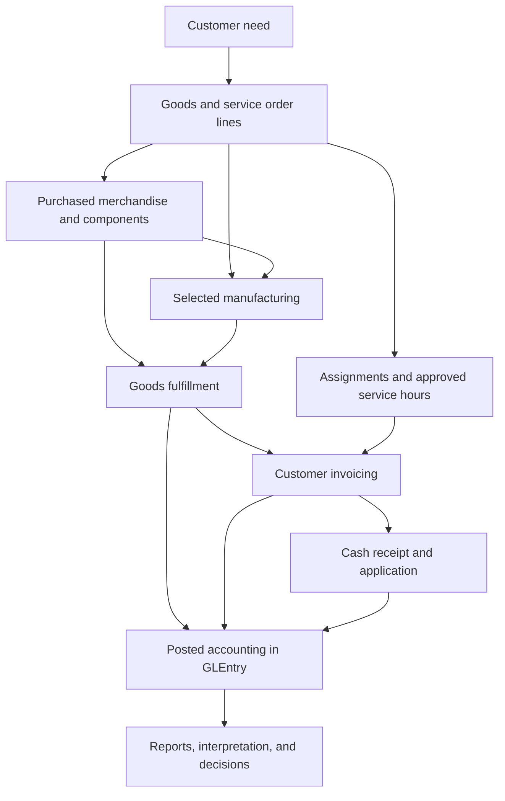

import CompanyStoryHero from "@site/src/components/CompanyStoryHero";

<CompanyStoryHero
  title="The Company"
  lead={
    <>
      <CompanyName /> is a fictional greater-Boston business with three connected
      activities: buying merchandise, manufacturing selected products, and
      providing hourly Design Services. Learn what moves through the business
      before following the accounting records it leaves behind.
    </>
  }
  anchors={[
    { label: "Place", value: "Greater Boston and the Charles River" },
    { label: "Products", value: "Furniture, lighting, textiles, and accessories" },
    { label: "Model", value: "Purchased goods, selected manufacturing, and hourly services" },
  ]}
  snapshotTitle="One company. Different ways to create value."
  snapshotText="A merchandise sale depends on available goods. A manufactured product also depends on components, work centers, and labor. A service engagement depends on people and approved hours. Each creates a different evidence trail."
  panels={[
    { title: "Merchandise", text: "Purchased finished goods connect supplier commitments, inventory receipts, customer fulfillment, and cash." },
    { title: "Manufacturing", text: "Selected products connect materials, work orders, labor support, standard cost, and production close." },
    { title: "Design Services", text: "Customer engagements connect staffing, approved hours, monthly invoices, and labor-margin interpretation." },
  ]}
/>

:::note A fictional company with a defined evidence boundary
The company setting makes the teaching environment understandable. The operating scenario below is illustrative: it does not identify a particular customer, order, or result. Claims about tables, processes, and accounting refer to the published dataset. Derive every numerical finding from the file assigned to you.
:::

## What the Company Does

A room brings together many kinds of products. Furniture, lighting, textiles, and accessories can belong to the same customer need while requiring different supply decisions. Charles River's catalog places these product families inside one business so students can study their relationships rather than treating sales, purchasing, and production as isolated exercises.

The company buys some finished goods for resale and makes a selected subset in-house. The item master identifies the actual supply mode, product group, collection, and style family. Purchasing also supplies raw materials and packaging used in production.

Why combine buying and making? As a business interpretation, purchased merchandise can broaden an assortment without requiring every item to use internal production capacity. Selected manufacturing can support a particular product offering while bringing component availability, scheduling, and cost control into the decision. These are reasons to investigate the model, not claims that the dataset proves a particular sourcing strategy is optimal.

## Who Buys and What They Need

The synthetic customer master uses the segment labels `Wholesale`, `Strategic`, `Small Business`, `Design Trade`, and `Design Services`. The labels give students dimensions for comparison; they do not by themselves prove contract terms, customer behavior, or profitability.

In the fictional setting, imagine a design-trade buyer coordinating several furnishing needs for a client. Product choice matters, but so do availability, delivery timing, pricing, and the advice needed to combine the pieces. That context creates a practical accounting question: how do a commercial promise, delivery, billing, and payment become different records at different times?

## A Second Revenue Model: Design Services

Goods create a physical fulfillment problem. Design Services creates a time-and-staffing problem. A service order line leads to an engagement, employee assignments, approved billable and non-billable hours, and monthly billing of approved billable time.

The revenue model is hourly. `ServiceBillingLine` connects the billed hours to the invoice line, while `ServiceTimeEntry` supplies approved hours and a labor-cost snapshot for analysis. Customer settlement uses the same invoice and cash-application structure as goods sales.

Service labor remains payroll expense. Comparing billed revenue with the approved time-cost snapshot supports a labor-margin view; it does not automatically measure the full profitability of an engagement after every organizational cost. The [Design Services process](../processes/design-services.md) explains that boundary.

## A Typical Operating Cycle

**Illustrative scenario:** a regional design buyer needs a coordinated selection of furnishings and some design support. This scenario explains how the processes connect. It is not a claim that a specific matching order exists in the published files.

1. **Sales records the promise.** Product lines describe the requested goods, and a separate service line describes hourly design work. An order records demand; it does not establish that goods shipped or revenue was posted.
2. **Operations checks supply.** Purchased merchandise depends on available inventory and supplier replenishment. Manufactured goods also depend on components, work orders, work-center schedules, and labor support.
3. **People carry out the work.** Warehouse staff receive and ship goods. Production issues materials and completes finished goods. Design staff record approved service hours. Payroll records wages and liabilities through its own cycle.
4. **Accounting recognizes the events.** Shipment, invoicing, receipt, payroll, and production events have different posting effects. Approved service hours become customer revenue through monthly service invoicing in this dataset.
5. **Cash and close follow.** Customer cash is applied against invoices. Supplier and payroll liabilities have their own settlement dates. Finance records estimates, reclasses, and close entries around those operating flows.
6. **An analyst explains the consequences.** A delivery delay, unbilled service workload, open receivable, or manufacturing variance calls for different evidence and a different follow-up decision.

The map shows business dependencies, not a set of direct database joins. Purchasing, manufacturing, and payroll also create their own accounting entries. The [Process Flows](process-flows.md) page connects those cycles in more detail.

## Departments Depend on One Another

| Team or function | Operating question | Evidence to investigate |
|---|---|---|
| Sales and customer accounting | What was promised, priced, delivered, billed, returned, and collected? | Sales orders, pricing records, shipments, invoices, credits, and cash applications |
| Purchasing and warehouse operations | What must be bought, when did it arrive, and what is still owed? | Planning recommendations, requisitions, purchase orders, receipts, supplier invoices, and payments |
| Production and planning | Can selected goods be made with the available materials, capacity, and labor? | BOMs, routings, schedules, work orders, issues, completions, and close records |
| Design Services | Who supports the engagement, which hours are billable, and what was invoiced? | Engagements, assignments, approved time, and service billing |
| Payroll and workforce supervision | Which hours were approved, which costs were posted, and which liabilities remain? | Rosters, attendance, labor entries, payroll registers, employee payments, and remittances |
| Finance | Do the source events support the balances and the period-end explanation? | `JournalEntry`, `GLEntry`, control-account reconciliations, asset records, and budgets |

These functions are a way to read the operating model. Use the stored employee and cost-center records when you need to establish an actual assignment or approval in the dataset.

## From an Event to a Decision

A business need becomes a source document. An accounting event becomes a posting. A group of postings becomes a report. The report becomes useful when an analyst checks its source, interprets the result, and identifies a defensible action.

For example, an apparent collection problem requires invoice and cash-application evidence, not only a sales total. An apparent production problem requires a distinction between planned capacity, recorded execution, and accounting close. An apparent service-margin problem requires a clear definition of which hours and costs were included.

The [Accounting Analytics textbook](https://aa.accountinganalyticshub.com/) develops the analytical methods behind those questions. This company supplies the common setting within [Accounting Analytics Hub](https://accountinganalyticshub.com/).

## Next Steps

1. Read [Process Flows](process-flows.md) and select one operating cycle.
2. Begin a focused task in [Learn and Practice](../learn-and-practice/index.md).
3. Move into the matching [case](../analytics/cases/index.md) or [report perspective](../analytics/reports/index.md) after you can explain the evidence trail.
