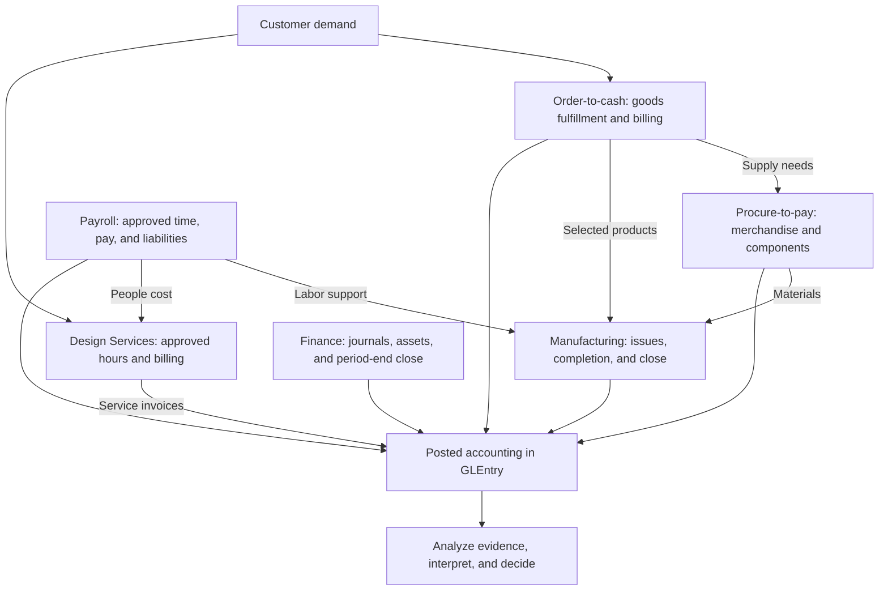

# Process Flows

Customer demand connects Charles River's departments. Sales needs goods to fulfill orders. Purchasing supports merchandise and components. Manufacturing uses materials and labor to make selected products. Design Services uses employee time to serve engagements. Finance records the accounting effects, settles obligations, and closes the period.

Read each cycle as a sequence of decisions and evidence. A document may record a promise, an approval, physical activity, an accounting event, or a settlement. Those meanings matter before you choose a join or total a column.

## The Connected Business

This is a conceptual process map. The arrows show dependencies and posting flows; they do not assert direct foreign keys. Planning, assignments, and approved time often support an accounting event without posting themselves.

## Three Core Process Modules

These modules establish the source-to-ledger foundation for AIS, accounting, and analytics work.

| Module | Business question | Evidence distinction | First practice |
|---|---|---|---|
| [Order-to-cash](../processes/o2c.md) | How does a customer promise become fulfillment, revenue, and collection? | Order, shipment, invoice, receipt, and cash application are separate events | [Trace a goods sale](../learn-and-practice/source-to-ledger.md) |
| [Procure-to-pay](../processes/p2p.md) | How does an operating need become inventory, a liability, and payment? | Requisition, commitment, receipt, invoice, and payment have different meanings | [Explain receipt and payable timing](../learn-and-practice/receipt-to-payable.md) |
| [Manufacturing and conversion](../processes/manufacturing.md) | How do materials and labor support finished goods and manufacturing cost? | Planning, execution, standard-cost completion, and close are separate layers | [Map manufacturing cost flow](../learn-and-practice/manufacturing-cost-flow.md) |

The modules can support an existing AIS course now. The complementary AIS textbook and Hub courses remain planned or in development; they are not required to use these process pages.

## Supporting and Connecting Cycles

| Process | What it adds | Main evidence boundary |
|---|---|---|
| [Design Services](../processes/design-services.md) | A second revenue model based on staffed engagements and hourly billing | Approved service hours support monthly billing; service work does not require shipment or inventory relief |
| [Payroll](../processes/payroll.md) | Approved hours, wages, employer costs, employee payment, and later remittances | Raw punches, approved time, payroll posting, and liability settlement are different evidence layers |
| [Manual Journals and Close](../processes/manual-journals-and-close.md) | Estimates, reclasses, fixed-asset and debt accounting, and year-end close | Finance-controlled entries complement the operational document chains |

## Read Every Process in the Same Order

1. Identify the **business need and decision**: customer demand, an internal purchasing requirement, production, service delivery, or a period-end estimate.
2. Identify the **source documents and grain**: what one header, line, approval, or event represents.
3. Distinguish **support from recognition**: a plan or approval can explain activity without creating a ledger entry.
4. Trace **posting and settlement** separately: the event creating a receivable or liability may precede the cash event.
5. Choose an **analysis and conclusion**: state the population, dates, evidence, limitations, and next action.

The [Dataset Guide](../start-here/dataset-overview.md) provides table-family navigation. The [Schema Reference](../reference/schema.md) provides stored keys. The [GLEntry Posting Reference](../reference/posting.md) provides event-specific accounting rules.

## Process to Analysis Bridges

| Process | Reports and perspectives | Guided case follow-through |
|---|---|---|
| [Order-to-cash](../processes/o2c.md) | [Commercial and Working Capital](../analytics/reports/commercial-and-working-capital.md), [Financial Reports](../analytics/reports/financial.md) | [O2C Trace Case](../analytics/cases/o2c-trace-case.md) |
| [Design Services](../processes/design-services.md) | [Commercial and Working Capital](../analytics/reports/commercial-and-working-capital.md), [Managerial Reports](../analytics/reports/managerial.md) | Compare engagement hours, billing, and labor-cost scope before moving to broader profitability work |
| [Procure-to-pay](../processes/p2p.md) | [Commercial and Working Capital](../analytics/reports/commercial-and-working-capital.md), [Financial Reports](../analytics/reports/financial.md) | [P2P Accrual Case](../analytics/cases/p2p-accrual-settlement-case.md) |
| [Manufacturing](../processes/manufacturing.md) | [Operations and Risk](../analytics/reports/operations-and-risk.md), [Managerial Reports](../analytics/reports/managerial.md) | [Manufacturing Labor Case](../analytics/cases/manufacturing-labor-cost-case.md) |
| [Payroll](../processes/payroll.md) | [Payroll and Workforce](../analytics/reports/payroll-perspective.md), [Audit Reports](../analytics/reports/audit.md) | [Workforce Cost and Org-Control Case](../analytics/cases/workforce-cost-and-org-control-case.md), [Attendance Control Audit Case](../analytics/cases/attendance-control-audit-case.md) |
| [Manual Journals and Close](../processes/manual-journals-and-close.md) | [Executive Overview](../analytics/reports/executive-overview.md), [Financial Reports](../analytics/reports/financial.md) | [Financial Statement Bridge Case](../analytics/cases/financial-statement-bridge-case.md) |

## Next Steps

Choose one core module, then complete its first task in [Learn and Practice](../learn-and-practice/index.md). Use [Analyze the Data](../analytics/index.md) to choose SQL, Excel, reports, or a case once the evidence chain is clear. For the conceptual framework alongside your investigation, open the [Accounting Analytics textbook](https://aa.accountinganalyticshub.com/).
