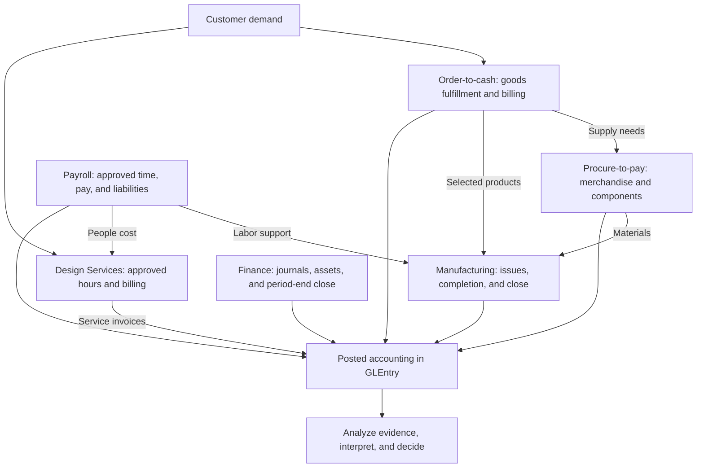

import BpmnDiagram, { BpmnModelCatalog } from "@site/src/components/BpmnDiagram";

# Business Processes and Models

Customer demand connects Charles River's departments. Sales needs goods to fulfill orders. Purchasing supports merchandise and components. Manufacturing uses materials and labor to make selected products. Design Services uses employee time to serve engagements. Finance records the accounting effects, settles obligations, and closes the period.

Read each cycle from business activity to accounting evidence. **BPMN** shows participants, responsibilities, events, and decisions. **Mermaid** shows information relationships and postings. The linked activities ask you to investigate those views using actual records. If BPMN is new to you, start with the [reading guide](#a-short-bpmn-reading-guide).

These models support the forthcoming *Accounting Information Systems: An Integrated Approach* and the current [Accounting Analytics textbook](https://aa.accountinganalyticshub.com/). They are reusable teaching models grounded in the published synthetic dataset.

## Business Process Architecture

<BpmnDiagram modelId="process-architecture" />

The architecture groups the company's business cycles and responsibilities. Each cycle has its own trigger and boundary; the drawing does not impose a single serial schedule on all transactions. Purchasing supplies merchandise and components, manufacturing supplies selected finished goods, payroll supports factory and service staff, and finance complements the operating cycles with journals and close.

The Mermaid map below connects those cycles through information and posting flows. Choose a detailed process guide and editable source in the [model library](#model-library).

## The Connected Business

This is a conceptual process map. The arrows show dependencies and posting flows; they do not assert direct foreign keys. Planning, assignments, and approved time often support an accounting event without posting themselves.

## Model Library

Begin with **Order-to-Cash**, **Procure-to-Pay**, or **Manufacturing and Conversion** for the three core AIS modules. Design Services, payroll, and finance connect those cycles to employee time, customer billing, settlement, and close. Focused detail models keep exceptions and proposed reviews separate from the main paths.

Each row links a model to its process guide, learning activity, case, and editable `.drawio` source. Click a diagram or its Expand model button to open the viewer. Download the source to adapt it in [diagrams.net](https://app.diagrams.net/) or Draw.io Desktop; keep proposed changes explicitly labeled. Viewing the published diagrams requires only a browser.

<BpmnModelCatalog />

## A Short BPMN Reading Guide

| Symbol or connector | Meaning in this library | Reading check |
|---|---|---|
| Thin start circle; thick end circle | A process instance begins or reaches its stated boundary | An end can mean an open item remains; read the label rather than assuming full settlement |
| Envelope in a start or double-ring intermediate circle | A message triggers a process or is awaited during it | Identify the other participant; a message is communication, not a ledger posting |
| Rounded task rectangle | An activity at the stated responsibility | Check its associated tables and evidence before inferring automation or authorization |
| Rounded activity with a boxed plus at the bottom | A collapsed subprocess with a separate detailed model | The plus is a subprocess marker, not a parallel gateway |
| Diamond with X | An exclusive decision or merge | Take one labeled alternative for the selected instance |
| Diamond with + | Parallel split or synchronization | All split branches are required; a join waits for every required incoming branch |
| Pool and lane | A participant boundary and responsibility within it | Charles River's lanes are internal; customers, suppliers, and agencies are separate pools |
| Solid arrow | Sequence within one pool | It may cross lanes but must not cross a participant boundary |
| Dashed arrow with open source circle and open target | Message between participants | It cannot be used as an internal lane-to-lane handoff |

Read the [OMG BPMN 2.0.2 specification](https://www.omg.org/spec/BPMN/2.0.2/) for the formal notation and [Draw.io's BPMN library guide](https://www.drawio.com/docs/diagram-types/bpmn-2-0/) for authoring. In a notation conflict, the OMG specification is authoritative. This introduction selects the symbols used here; it does not reproduce the full standard.

## Evidence and Control Boundaries

A stored approver, status, or posting link can support a specific test. It does not establish that every transaction was approved, that people had incompatible duties, or that an exception was automatically blocked. Compare actual source records at the correct dates and grain.

Reconciliations, independent review, holds, and segregation-of-duties improvements that are not represented by a documented field or event are **proposed teaching controls**. Identify them in your annotations and risk/control matrix. Do not present a proposed queue, credit policy, or automated matching rule as a feature of the published dataset.

These `.drawio` files use Draw.io's native XML format. They are **editable visual models, not standards-compliant executable BPMN XML**. Execution or interchange with a BPMN engine would require a separate BPMN export, modeling review, and schema/engine validation.

## Read Every Process in the Same Order

1. Identify the **business need and decision**: customer demand, an internal purchasing requirement, production, service delivery, or a period-end estimate.
2. Read the **BPMN participants and activities**: follow the trigger, responsibility handoffs, labeled decision paths, and stated end boundary.
3. Identify the **source documents and grain** in the Mermaid views: what one header, line, approval, or event represents.
4. Distinguish **support from recognition**: a plan or approval can explain activity without creating a ledger entry.
5. Trace **posting and settlement** separately: the event creating a receivable or liability may precede the cash event.
6. Choose an **analysis and conclusion**: state the population, dates, evidence, limitations, and next action.

The [Dataset Guide](../start-here/dataset-overview.md) provides table-family navigation. The [Schema Reference](../reference/schema.md) provides stored keys. The [GLEntry Posting Reference](../reference/posting.md) provides event-specific accounting rules.

Each major process page includes an optional AIS activity that moves from model interpretation to a supported risk/control evaluation. The [BPMN and controls workshop](../learn-and-practice/bpmn-controls-workshop.md) provides a common evidence workflow and reusable matrix. These activities support current classroom work and the forthcoming AIS textbook; they do not imply that a future Hub course is already available.

## Process to Analysis Bridges

The model library supplies the focused activities and cases. These report perspectives extend a trace into a wider population.

| Process | Reports and perspectives |
|---|---|
| [Order-to-cash](../processes/o2c.md) | [Commercial and Working Capital](../analytics/reports/commercial-and-working-capital.md), [Financial Reports](../analytics/reports/financial.md) |
| [Design Services](../processes/design-services.md) | [Commercial and Working Capital](../analytics/reports/commercial-and-working-capital.md), [Managerial Reports](../analytics/reports/managerial.md) |
| [Procure-to-pay](../processes/p2p.md) | [Commercial and Working Capital](../analytics/reports/commercial-and-working-capital.md), [Financial Reports](../analytics/reports/financial.md) |
| [Manufacturing](../processes/manufacturing.md) | [Operations and Risk](../analytics/reports/operations-and-risk.md), [Managerial Reports](../analytics/reports/managerial.md) |
| [Payroll](../processes/payroll.md) | [Payroll and Workforce](../analytics/reports/payroll-perspective.md), [Audit Reports](../analytics/reports/audit.md) |
| [Manual Journals and Close](../processes/manual-journals-and-close.md) | [Executive Overview](../analytics/reports/executive-overview.md), [Financial Reports](../analytics/reports/financial.md) |

For a broader comparison of payroll responsibilities and employee costs, continue to the [Workforce Cost and Org-Control Case](../analytics/cases/workforce-cost-and-org-control-case.md).

## Next Steps

Choose one core module, then complete its first task in [Learn and Practice](../learn-and-practice/index.md). Use [Analyze the Data](../analytics/index.md) to choose SQL, Excel, reports, or a case once the evidence chain is clear. The [instructor guide](../teach-with-data/instructor-guide.md) proposes a 14-week AIS sequence and ways to adapt these modules for a course.
