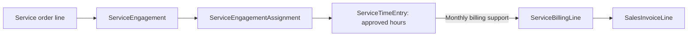
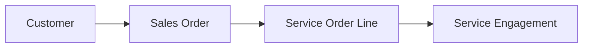
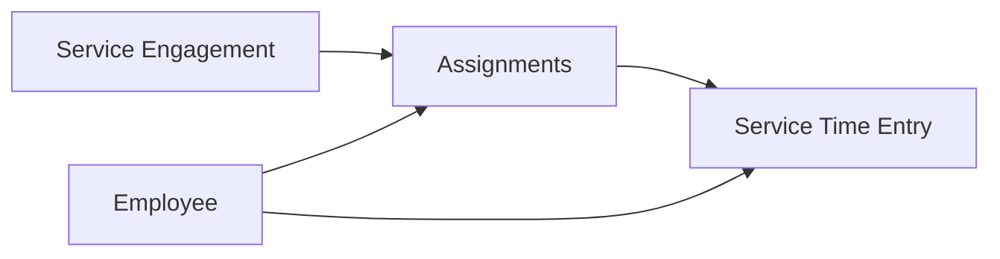
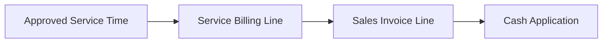

import BpmnDiagram from "@site/src/components/BpmnDiagram";

# Design Services Process

## The Customer Also Needs Design Help

The customer in our furnishing story needs advice as well as products. The sales coordinator passes the service need to the design lead, who must arrange the people and work behind the engagement. The central question changes: **how does staff time become a supported customer invoice?**

Follow the design lead's handoffs from staffing to approved time and monthly billing. As you read, ask what accounting would need to see before charging the customer. The optional sections identify records for a later investigation.

In [Order-to-Cash](o2c.md), goods left inventory before they were billed. Design services rely on an engagement, staff assignments, and approved hours. Customer invoicing and cash settlement eventually use the same receivable structure, but the evidence of delivery is different.

## Establish the Engagement and Assign People

The service order line records customer demand. An **engagement** organizes the design work associated with that demand, and assignments identify the employees supporting it.

The design lead considers who will perform the work. Staffing makes the service possible, but an assignment alone does not show how many hours were worked. It also does not establish that the customer has been billed. Those questions need later records.

This distinction helps explain different kinds of delay. An engagement may exist before the work is performed, and staff may perform work before the monthly billing event. To explain the position, establish which stage has actually been reached.

## Record and Approve the Work

Design staff record time against the engagement. **Billable hours** are hours recorded for customer charging. **Non-billable hours** capture work that is not charged as billable time. Both can consume employee effort.

Approval supplies the time support used by the model. The approved records distinguish the hours worked from the staff assignment that made the work possible. For a particular investigation, inspect the approval fields and dates rather than assuming that the presence of an engagement proves all its time was approved.

The design lead's operational question is about the work and its support. Accounting's next question is about billing: which approved billable hours belong in the monthly invoice? Keeping those questions separate makes unbilled work easier to explain.

## Prepare the Monthly Customer Invoice

In this dataset, monthly service billing brings approved billable time into a customer invoice. The billing record connects billed hours to the invoice line. It does not rely on a physical shipment.

The service invoice creates accounts receivable and design-service revenue, with applicable tax recorded. Creating an engagement or approving time does not itself post that customer revenue in this model. This describes the dataset's posting design; it is not a rule for every service contract.

The customer's eventual payment follows the [cash receipt and application path](o2c.md#receive-the-money-and-apply-it) already introduced. A service invoice can be open at a reporting date just as a goods invoice can. The receipt and its applications establish settlement.

## Follow the Service Responsibilities

**Where does responsibility pass from the design team to accounting?** Begin with the engagement, follow staffing and time approval, and then locate monthly billing.

<BpmnDiagram modelId="design-services" />

The design team supplies the support for hours; accounting uses the billing records to establish what reached the invoice. Treasury and customer accounting handle money and its application after billing.

Read the model as responsibilities and activities. It does not establish an additional customer-acceptance workflow or prove that every approval was independent. Those claims would require their own evidence.

## Connect Work, Billing, and Cost

The record map asks **how work and billing are related without using shipment evidence**.

Follow the engagement through its staff support, then compare approved time with the monthly billing records. The map summarizes the path; a monthly billing row must not be treated as a separate invoice for every daily time row.

Four amounts answer different questions. The **billing price** determines the customer charge for billed hours. The **time-cost snapshot** supports analysis of the labor associated with an engagement. **Payroll expense** records employee costs in the pay cycle. **Service revenue** comes from the posted invoice.

The service-time records include a cost rate and extended cost for analysis. Those snapshots do not turn design work into manufactured inventory. Design-service labor remains payroll period expense.

A comparison of billed revenue and the included time cost can describe a labor-margin view. To interpret it, state whether billable and non-billable work are included, which period you are comparing, and which costs are outside the calculation. It does not automatically measure the engagement's profit after every organizational expense.

## Explain Work That Has Not Yet Been Billed

At period end, the controller may ask why approved work and invoiced revenue do not line up. Start by checking the time dates, approval dates, billing period, and invoice evidence.

Approved time can establish supported work without establishing that it has already reached a posted invoice. Non-billable time can represent employee effort without contributing billable hours. These distinctions give you specific explanations to test before describing a billing failure or weak service performance.

## Bridge an Event to an Entry

Reuse [Lesson 7’s engagement 2](../learn-and-practice/follow-design-time-into-billing.md). This is a separate verified example; it is not an extension of the selected goods sale.

| Event and date basis | Supporting evidence | Why the accounts change | Cutoff question |
|---|---|---|---|
| Engagement setup and assignment dates | ServiceEngagement and ServiceEngagementAssignment | No posting: staffing a promise does not create customer revenue | Which work is supported, and for which period? |
| January 2024 work, approved by January 31 | Seven selected ServiceTimeEntry rows | No posting: approved hours and time-cost snapshots support billing and analysis | Is the time approved and within the billed work period? |
| January 31 invoice | ServiceBillingLine 2 → invoice line 387 → SalesInvoice 241 | Debit AR; credit design-service revenue and applicable sales tax payable | Is the invoice posted by cutoff, and how much remains unsettled? |
| Receipt date, then application date | CashReceipt and CashReceiptApplication | Receipt: debit cash / credit unapplied money. Application: debit unapplied money / credit AR | Which event has actually occurred by cutoff? |

**Predict before revealing:** Can you call the selected 937.02 time-cost snapshot a payroll posting or subtract it from revenue and report full engagement profit?

Reveal the recognition and cost boundaries

No. Lesson 7 verifies 32.67 billed hours × 210.00 = 6,860.70 on invoice line 387. The **complete invoice** debits AR 7,306.65 and credits service revenue 6,860.70 plus tax payable 445.95; its three ledger rows balance. The 937.02 is time-cost support including selected non-billable work, rather than a payroll reconciliation or all engagement costs. This release recognizes service revenue at invoicing; use that dataset convention when interpreting the trace.

## Check Your Understanding

Does an approved service-time row establish posted customer revenue?

No. It supports the work and its billable or non-billable hours. The monthly billing and invoice records establish what was billed and posted as service revenue in this dataset.

Does billed revenue less the recorded time cost establish total engagement profit?

It establishes only the margin defined by the revenue and costs included. State the treatment of non-billable time, timing, and costs outside the snapshot before interpreting the result.

## Next Steps

**Continue the company story.** The customer-facing work depends on resources available inside the company. Continue to [Procure-to-Pay](p2p.md) to follow merchandise and material needs into supplier commitments, receipts, and payments.

**Investigate this process.** Finish [Lesson 1](../learn-and-practice/meet-the-records.md), [Lesson 2](../learn-and-practice/read-an-order.md), and [Lesson 3](../learn-and-practice/connect-the-records.md), plus [Excel setup](../analytics/excel-guide.md) or [SQL setup](../analytics/sql-guide.md). Then follow [Lesson 7: Follow Design Time into Billing](../learn-and-practice/follow-design-time-into-billing.md). Check the selected lesson’s further prerequisites before beginning.

## Optional Reference

Return to these sections when you have a specific question or an assignment that uses the data. The chapter above can be read without opening a file.

Look up documents, accounting entries, and traceability fields

### Core Tables and What They Represent

| Process stage | Main tables | Grain or event represented | Why students use them |
|---|---|---|---|
| Customer demand | `SalesOrder`, `SalesOrderLine` | One customer order and ordered service line | Shows the original commercial promise, hourly rate, and planned service hours |
| Engagement setup | `ServiceEngagement` | One customer service job tied to one service order line | Anchors customer, service item, lead employee, planned hours, and engagement dates |
| Staffing | `ServiceEngagementAssignment` | One employee assignment on one engagement | Shows how many employees supported the same engagement and how hours were assigned |
| Approved service delivery | `ServiceTimeEntry` | One approved service-work day for one employee and engagement | Measures billable versus non-billable hours and snapshots labor cost for margin analysis |
| Monthly billing trace | `ServiceBillingLine` | One invoiced billing slice for approved hours | Connects approved hours to the exact `SalesInvoiceLine` used to bill the customer |
| Customer billing and settlement | `SalesInvoice`, `SalesInvoiceLine`, `CashReceipt`, `CashReceiptApplication` | Invoice, receipt, and settlement events | Completes the AR and cash path using the normal O2C backbone |
| Payroll support | `PayrollRegister`, `PayrollRegisterLine` | Gross-to-net payroll for the service staff | Keeps payroll expense and liability activity visible beside the customer-billing flow |

### When Accounting Happens

| Event | Business meaning | Accounting effect |
|---|---|---|
| Service order and engagement setup | Customer demand is accepted and staffed | No direct posting |
| Approved service time | Managers approve billable and non-billable hours worked on the engagement | No direct posting |
| Monthly service invoice | Accounting bills approved billable hours for the period | Debit accounts receivable and credit `4080` Sales Revenue - Design Services plus sales tax payable |
| Cash receipt and application | Treasury receives customer cash and later settles the invoice | Same customer-deposit and AR-clearing pattern used in O2C |
| Payroll register | Payroll records the wages and burden for service employees | Debits `6280` Salaries Expense - Design Services and related payroll expense pools, then credits accrued payroll and payroll liabilities |

### Key Traceability and Data Notes

- `ServiceEngagement.SalesOrderLineID` is the bridge from customer demand into service delivery.
- `ServiceEngagementAssignment` lets several employees work on the same engagement while preserving assigned-role detail.
- `ServiceTimeEntry` stores both `BillableHours` and `NonBillableHours`, plus `CostRateUsed` and `ExtendedCost` for labor-margin analysis.
- `ServiceBillingLine` is the authoritative hours-to-invoice bridge for services. Use it instead of trying to infer service billing from `SalesInvoiceLine` alone.
- Service invoice lines stay in `SalesInvoiceLine`, but `ShipmentLineID` remains null for those rows because nothing shipped physically.
- Payroll supports the same employees, but service labor is analyzed through `ServiceTimeEntry` rather than capitalized into manufacturing inventory.

Explore detailed process and analysis paths

### Analytical Subsections

### 1. Customer Demand to Engagement Setup

The process begins on the customer side. A service line is created on the sales order, then the operating team opens an engagement that carries planned hours, the lead employee, and the expected delivery window.

**Starter analytical question:** Which customers create the most planned design-service hours, and how concentrated is that workload?

### 2. Staffing and Approved Time

Once the engagement is active, the company assigns one or more employees to it. Approved daily service time then accumulates by employee and date. This layer is where students can compare planned hours, assigned hours, billable hours, non-billable hours, and cost snapshots.

**Starter analytical question:** Which engagements rely most on senior-designer time versus designer time, and where do non-billable hours accumulate?

### 3. Monthly Billing and Settlement

Billing does not happen every time an employee works. The dataset bills approved billable hours monthly. `ServiceBillingLine` stores the rolled-up hours for that invoice line, which makes it the main student bridge between approved service delivery and posted customer revenue.

**Starter analytical question:** Which customers show the biggest difference between approved service hours and billed service hours at month-end?

### 4. Payroll and Service Margin Interpretation

Service employees also pass through normal payroll. Billing and receivables belong to the customer process; employee costs and payroll liabilities belong to the pay cycle. Compare billed revenue with the included `ServiceTimeEntry.ExtendedCost` snapshots to explain a labor-margin view, stating its cost and timing limits.

**Starter analytical question:** Which engagements show the strongest labor margin after comparing billed revenue to the approved time-cost snapshot?

Evaluate controls and try the optional AIS activity

### Risks, Controls, and Evidence

| Risk and control objective | Evidence available | Teaching boundary |
|---|---|---|
| Unsupported service hours: connect staff and approved time to an engagement | `ServiceEngagementAssignment`, `ServiceTimeEntry` approval fields | Test approval support and assignment links; a recorded approver alone does not establish the effectiveness of time review |
| Missing or incorrect billing: connect approved billable hours to the monthly invoice | `ServiceBillingLine.ServiceEngagementID`, `SalesInvoiceLineID`, and billing-period dates | An independent hours-to-billing reconciliation is a **proposed teaching control**, not a documented automated hold |
| Misleading margin: keep customer billing and labor cost on stated bases | `ServiceTimeEntry.ExtendedCost`, billable and non-billable hours, invoice-line revenue | This is a labor-cost analytical bridge; it does not establish full engagement profitability or capitalize service payroll into inventory |

### Optional AIS Activity: Review Approved Hours and Billing

**Context and objective:** an engagement lead and accounting need to understand whether approved service effort was billed on the intended monthly basis. Interpret the service process and evaluate one risk at the handoff from time approval to billing.

**Prerequisites, tools, and sources:** read the O2C cash-application discussion and this page's billing bridge. Use a SQL tool with the published SQLite file, or Excel filters and lookups, plus a copy of the editable Draw.io model. Sources are `SalesOrderLine`, `ServiceEngagement`, `ServiceEngagementAssignment`, `ServiceTimeEntry`, `ServiceBillingLine`, `SalesInvoiceLine`, `SalesInvoice`, and `GLEntry`; add payroll records only when explaining the separately defined employee-cost scope.

1. Record the source file, engagement, billing period, and reporting date. Mark the relevant activities and responsible roles on the model.
2. Compare approved billable hours, non-billable hours, and billed hours for the period. Preserve the monthly rollup grain and explain date or scope differences before calling them missing revenue.
3. Add one **proposed teaching control** for time approval or billing completeness. State the risk, objective, owner, source evidence, reproducible test, and limitation using the [workshop matrix](../learn-and-practice/bpmn-controls-workshop.md).

**Assessed deliverable:** submit an annotated model, an engagement-period evidence schedule, and the risk/control row. Explain the effect of a supported difference on billing or staffing decisions. Do not invent a customer sign-off, link individual time rows directly to an invoice without the billing bridge, or treat the labor-cost snapshot as all service costs. Continue through the existing commercial and managerial reports below for broader interpretation.

Choose a further investigation

### Questions for Further Investigation {#common-student-questions}

- Which customers buy only goods, which buy design services, and which buy both?
- How many employees typically support one design-service engagement?
- Which service hours were billable versus non-billable?
- Which approved hours remain unbilled at the end of the month?
- How do service invoices differ from shipment-based goods invoices?
- Where does payroll expense sit for design staff, and why does that not create manufacturing cost?

- Read [O2C](o2c.md) when you want the broader customer-demand and settlement cycle around invoices, cash, returns, and working capital.
- Read [Payroll](payroll.md) when you want the payroll posting, liability, and cash-settlement side of the same service staff.
- Read [Sales and Customers](../analytics/index.md#sales-and-customers) to compare service revenue and billed hours.
- Read [Schema Reference](../reference/schema.md) and [GLEntry Posting Reference](../reference/posting.md) when you need the exact joins and posting rules.

