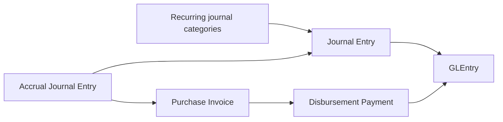
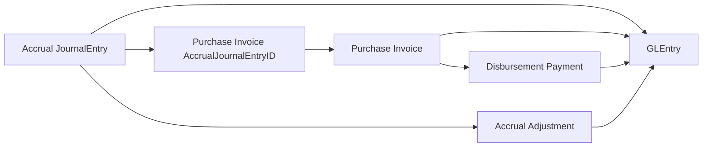
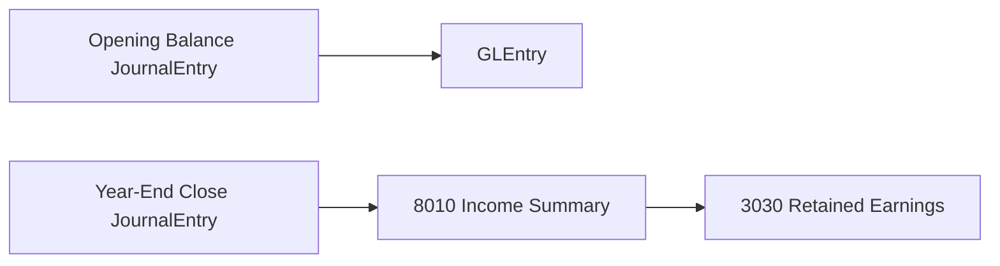

import BpmnDiagram from "@site/src/components/BpmnDiagram";

# Manual Journals and Close Cycle

## Business Storyline

**Illustrative scenario:** at period end, Charles River finance needs to recognize an expense estimate, explain its support, and distinguish that estimate from later supplier settlement. Annual close introduces a separate reporting boundary. Select actual journals and links from your assigned file; this scenario does not establish an unrecorded close checklist or sign-off procedure.

The dataset includes both operational activity and finance-controlled journal activity. Finance records the recurring and period-end entries that students expect in a real accounting system: rent, utilities, depreciation, month-end accruals, accrual adjustments, factory-overhead journals, fixed-asset debt reclasses, debt payments, asset disposals, and year-end close.

This process shows what happens outside the normal document chains. Students can compare operational postings from shipments, receipts, payroll, and purchasing with finance-controlled entries that start directly in the journal process. The most important cross-process bridge is accrued-expense settlement, where a finance estimate is later cleared operationally through AP.

That distinction matters. A recurring journal is not an operational source document. An accrual is not the same thing as the later supplier invoice that clears it. A year-end close is not just another monthly recurring journal. Students can see those stages separately in the data and use that separation for financial-accounting, working-capital, and audit questions.

## What Students Should Learn

- Distinguish recurring finance-controlled journals, accrued-expense settlement, and boundary entries such as opening balance and year-end close.
- Trace a manual or finance-controlled posting from `JournalEntry` into `GLEntry` and, when relevant, into later AP settlement.
- Identify the core tables used for recurring journals, manufacturing reclass support, accrual cleanup, and close-cycle analysis.
- Recognize which journal families belong in recurring monthly analysis and which should be filtered from raw multi-year P&L review.

## Decisions and Evidence

Finance must explain both the posting and the period it belongs to. An estimate, a later supplier invoice, a payment, and an accrual adjustment can relate to the same underlying need while answering different recognition and settlement questions. Asset depreciation and financing also require their own register or schedule support.

Begin by tracing one journal type into `GLEntry` and stating its purpose. Use the [Financial Statement Bridge Case](../analytics/cases/financial-statement-bridge-case.md) for the wider reconciliation. Keep opening and year-end closing entries visible in a balance reconciliation while applying the documented close-entry exclusions when analyzing operating P&L activity.

## Participants and Responsibilities

The **Preparer** assembles a finance-controlled entry, an **Approver** supplies the approval represented on the journal header, and **Accounting or the Controller** interprets the posted result and close boundary. **AP** and **Treasury** participate when an accrual is later invoiced and paid. These are modeled responsibilities; compare `CreatedByEmployeeID` and `ApprovedByEmployeeID` before making any claim about independent review.

## BPMN Business Process

<BpmnDiagram modelId="manual-journals-close" />

### Interpret the Activities and Decisions

1. A finance-calendar event or accounting need begins preparation of a supported journal. Approval metadata and posted ledger detail are different evidence layers; there is no separate journal-line table.
2. The entry reaches `GLEntry`, where accounts, dates, and debit/credit effects can be inspected. A balanced entry alone does not establish the correctness of its business purpose or period.
3. Year-end close is a separate branch that moves P&L through income summary to retained earnings. Routine monthly entries do not all traverse that annual boundary.

Follow an accrual into supplier settlement

<BpmnDiagram modelId="accrual-settlement" />

The original estimate, a later direct service invoice, any linked residual adjustment, and disbursement remain separate events. The invoice uses `AccrualJournalEntryID`; it does not require a physical receipt. An estimate can remain outstanding at a reporting date.

### Risks, Controls, and Evidence

| Risk and control objective | Evidence available | Teaching boundary |
|---|---|---|
| Unsupported journal: identify preparation and approval support | `JournalEntry` creator, approver, and date fields, plus `GLEntry` | Test actual identities and dates; the diagram does not establish an enforced independent-review workflow |
| Duplicate recognition or stale estimate: distinguish accrual from later AP settlement | `PurchaseInvoiceLine.AccrualJournalEntryID`, `JournalEntry.ReversesJournalEntryID`, `GLEntry` | An independent accrual roll-forward is a **proposed teaching control**; missing later settlement at cutoff is not automatically an error |
| Misstated operating analysis: distinguish routine activity from close boundaries | `JournalEntry.EntryType`, posting dates, accounts, and ledger source fields | An independent close reconciliation is a **proposed teaching control**; a year-end entry is not ordinary operating revenue or expense |

The Mermaid views below show journal, settlement, and accounting relationships. The [model library](../learn-the-business/process-flows.md#model-library) includes notation guidance and editable sources.

## Normal Process Overview

Read the main diagram as a finance calendar. Most of the page is about recurring monthly journals that start directly in `JournalEntry` and post into `GLEntry`. The main bridge back into an operational process is accrued-expense settlement, where a prior estimate is later cleared through AP.

## How to Read This Process in the Data

This page is organized around business flow first and data navigation second. The main diagram shows the recurring finance-controlled path. The smaller diagrams below show one analytical task at a time, such as recurring operating journals, manufacturing-support reclasses, or accrual settlement. The fuller relationship map belongs on [Schema Reference](../reference/schema.md), not on this process page.

:::tip
Read this page in three passes: first recurring journals, then the accrual-settlement bridge, then the boundary entries for opening balance and year-end close.
:::

## Core Tables and What They Represent

| Process stage | Main tables | Grain or event represented | Why students use them |
|---|---|---|---|
| Recurring finance journals | `JournalEntry`, `GLEntry`, `Account`, `CostCenter`, `Employee` | One finance-controlled journal header with posted ledger detail | Review recurring expenses, approvals, and posted accounting effect |
| Manufacturing-support journals | `JournalEntry`, `GLEntry`, `Account` | Factory overhead posted directly to manufacturing clearing | Connect finance-controlled journals to manufacturing costing support |
| Fixed-asset and debt journals | `JournalEntry`, `GLEntry`, `FixedAsset`, `FixedAssetEvent`, `DebtAgreement`, `DebtScheduleLine` | Depreciation, debt reclass, note payment, and disposal events that complete the asset lifecycle | Tie the asset register back to manufacturing cost, operating expense, financing cash, and gain-or-loss accounting |
| Accrual settlement bridge | `JournalEntry`, `PurchaseInvoice`, `PurchaseInvoiceLine`, `DisbursementPayment` | Prior expense estimate and later AP settlement path | Analyze accrued-expense roll-forward and later supplier settlement |
| Boundary entries | `JournalEntry`, `GLEntry`, `Account` | Opening balance and year-end close journal activity | Understand the start and end boundaries of the reporting cycle |

## When Accounting Happens

| Event | Business meaning | Accounting effect |
|---|---|---|
| Recurring operating journal | Finance records a monthly expense or estimate directly in the journal cycle | Debit expense or clearing accounts and credit cash, accrued expenses, or other offset accounts depending on entry type |
| Manufacturing-support journal | Finance records factory overhead directly into manufacturing costing support | Debit manufacturing clearing, or manufacturing variance when the month has no capitalizable direct labor, and credit cash |
| Debt reclass | Finance converts a note-financed CAPEX invoice from AP into notes payable | Debit `2010` Accounts Payable and credit `2110` Notes Payable |
| Debt principal payment | Finance records scheduled principal payment on a CAPEX note | Debit `2110` Notes Payable and credit cash |
| Interest payment | Finance records the interest portion of a CAPEX note payment | Debit `7030` Interest Expense and credit cash |
| Asset disposal | Finance removes the disposed asset, clears accumulated depreciation, and records any proceeds or gain or loss | Debit cash proceeds and accumulated depreciation, credit the gross asset account, and plug the residual to `7020` Gain or Loss on Asset Disposal |
| Accrual adjustment | Finance reverses the residual from an accrual after a linked supplier invoice or partially cleans up a stale uninvoiced estimate | Debit `2040` Accrued Expenses and credit the original accrued expense account |
| Direct service supplier invoice | AP clears a prior accrual through a later service invoice | Debit `2040` up to the estimate, expense any excess above estimate, and credit AP |
| Disbursement payment | Treasury clears the AP created by the service invoice | Debit AP and credit cash |
| Opening balance journal | Finance establishes the starting financial position | Seeds the beginning asset, liability, equity, and retained-earnings balances |
| Year-end close | Finance closes annual P&L activity into income summary and retained earnings | Moves annual revenue and expense balances through `8010` Income Summary into `3030` Retained Earnings |

## Key Traceability and Data Notes

- `JournalEntry` is the journal header anchor for finance-controlled activity. There is no separate journal-line table in the current model.
- `GLEntry` is the posted detail layer and the main bridge into financial reporting and control-account analysis.
- `PurchaseInvoiceLine.AccrualJournalEntryID` is the authoritative link from a direct service invoice line back to the original accrual.
- `PurchaseInvoiceLine.GoodsReceiptLineID` belongs to receipt-matched inventory or material invoicing and should not be confused with accrued-service settlement.
- `FixedAssetEvent.JournalEntryID` and `DebtScheduleLine.JournalEntryID` extend the journal trail into note-financed CAPEX, monthly debt payments, and disposal accounting.
- `ReversesJournalEntryID` is used on `Accrual Adjustment` cleanup activity that points back to the original accrual.
- Payroll is operationally modeled through payroll tables, so payroll accrual and settlement journals are not part of this recurring-journal set.
- For raw multi-year income-statement analysis, filter out the year-end close entry types.

## Analytical Subsections

### Recurring Operating Journals

Most manual journal activity in the dataset follows a recurring finance calendar. Students should use this subsection for rent, utilities, depreciation, and month-end accruals that start directly in `JournalEntry` without an earlier operational source document.

**Tables involved**

| Table | Role in the flow |
|---|---|
| `JournalEntry` | Shows posting date, entry type, approval support, and reversal linkage |
| `GLEntry` | Shows posted debit and credit detail |
| `Account` | Shows which balances the journal affected |
| `CostCenter`, `Employee` | Support ownership, approvals, and recurring journal analysis |

**Starter analytical question:** Which recurring journal families appear each month, and how stable are they by amount and cost center?

**Analytical plan**

- Objective: Compare recurring journal families across months and cost centers.
- Evidence path: JournalEntry -> GLEntry -> Account, with CostCenter when available.
- Comparison: Group by EntryType, month, account, or cost center.

### Factory Overhead Journals

Some finance-controlled journals support manufacturing costing even though they do not start in the manufacturing subledger. Students should read these entries as accounting support for the factory-cost story, not as replacements for the operational manufacturing documents.

**Tables involved**

| Table | Role in the flow |
|---|---|
| `JournalEntry` | Stores the factory-overhead journal headers |
| `GLEntry` | Shows the posted effect on manufacturing clearing and cash |
| `Account` | Helps separate manufacturing clearing from operating-expense accounts that stay outside overhead |

Warehouse payroll, warehouse rent, and warehouse supplies stay in operating expense in this model. The warehouse function is treated as support and distribution activity, not factory overhead absorbed into product cost.

**Starter analytical question:** How much finance-controlled factory-overhead activity exists beside the operational manufacturing postings in each month?

**Analytical plan**

- Objective: Isolate finance-controlled manufacturing support journals from operational manufacturing postings.
- Evidence path: JournalEntry -> GLEntry -> Account.
- Comparison: Filter EntryType to Factory Overhead.

### Accrual Estimate to AP Settlement

This is the most important subprocess on the page. Students should learn that finance-managed accrued expenses are usually cleared later through AP rather than blanket-reversed at month end. Finance records the estimate first, AP later clears it through a direct service invoice, treasury pays it later, and any under-accrual residual is reversed through a linked `Accrual Adjustment`. Only stale uninvoiced accruals keep the rare partial-cleanup pattern. In the wider dataset, `2040` also carries outbound-freight timing from O2C, but that operational use sits outside this finance-controlled accrual path.

**Tables involved**

| Table | Role in the flow |
|---|---|
| `JournalEntry` | Stores the original accrual estimate and any later adjustment |
| `PurchaseInvoiceLine` | Stores the direct service settlement link back to the accrual |
| `PurchaseInvoice` | Stores the supplier invoice that clears the estimate through AP |
| `DisbursementPayment` | Shows when the later AP balance was actually paid |
| `GLEntry` | Shows the liability roll-forward and later settlement effect |

:::warning
Use `PurchaseInvoiceLine.AccrualJournalEntryID` for accrued-service settlement. Do not substitute `PurchaseInvoiceLine.GoodsReceiptLineID`, because that field belongs to receipt-matched inventory or material invoicing.
:::

**Key joins**

- `PurchaseInvoiceLine.AccrualJournalEntryID -> JournalEntry.JournalEntryID`
- `PurchaseInvoiceLine.PurchaseInvoiceID -> PurchaseInvoice.PurchaseInvoiceID`
- `DisbursementPayment.PurchaseInvoiceID -> PurchaseInvoice.PurchaseInvoiceID`
- `JournalEntry.ReversesJournalEntryID` for linked `Accrual Adjustment` cleanup review

**Analytical plan**

- Objective: Trace an accrued expense from the original estimate into later AP settlement and linked cleanup activity.
- Evidence path: JournalEntry -> PurchaseInvoiceLine -> PurchaseInvoice -> DisbursementPayment.
- Comparison: Compare accrual date, invoice approval date, payment date, and any later accrual adjustment.

## Opening Balance and Year-End Close

Opening balance and year-end close are boundary entries, not recurring monthly process steps. Opening balance establishes the starting financial position for the dataset. Year-end close is the reporting-boundary mechanism that closes annual P&L activity through income summary and retained earnings.

| Boundary event | Main tables | Why students use them |
|---|---|---|
| Opening balance | `JournalEntry`, `GLEntry`, `Account` | Understand the seeded starting financial position |
| Year-end close | `JournalEntry`, `GLEntry`, `Account` | Understand how annual P&L balances are closed out of raw multi-year reporting |

| Event | Business meaning | Accounting effect |
|---|---|---|
| Opening balance journal | Seeds the starting position at the beginning of the dataset horizon | Posts the initial asset, liability, equity, and retained-earnings balances |
| Year-end close: P&L to income summary | Closes annual revenue and expense accounts | Moves annual P&L balances into `8010` Income Summary |
| Year-end close: income summary to retained earnings | Clears income summary into retained earnings | Moves the annual result into `3030` Retained Earnings |

**Traceability notes**

- `JournalEntry` remains the journal header anchor for both opening balance and year-end close.
- `GLEntry` remains the posted detail layer students should use for financial-statement analysis.
- Year-end close entries should be filtered from raw multi-year P&L analysis when students want underlying operating activity instead of formal close mechanics.

## Optional AIS Activity: Evaluate an Accrual or Close Review

**Context and objective:** finance needs a supported explanation of one estimate or reporting-boundary entry. Locate preparation, approval, posting, and any later settlement evidence, then propose a review that addresses a defined risk.

**Prerequisites, tools, and sources:** review accrual recognition, liabilities, and closing entries. Use a SQL tool with the published SQLite file, or Excel filters and lookups, plus a copy of the editable Draw.io model. Sources are `JournalEntry`, `GLEntry`, `Account`, and, for an accrued service, `PurchaseInvoiceLine`, `PurchaseInvoice`, and `DisbursementPayment`. Use fixed-asset and debt records only when the chosen journal family requires them.

1. Record the release, journal type, reporting date, and actual keys. Mark the entry's purpose, preparation, approval, and posting on the model.
2. Trace the entry to ledger detail and retain the relevant date boundaries. For an accrual, inspect linked invoices and adjustments without assuming blanket reversal; for close, distinguish operating activity from the annual transfer.
3. Add one **proposed teaching control** for approval, accrual review, or close reconciliation. Specify the risk, objective, owner, evidence, test, and limitation in the [workshop matrix](../learn-and-practice/bpmn-controls-workshop.md).

**Assessed deliverable:** submit an annotated model, a reproducible journal-to-ledger schedule, and the risk/control row. Explain what finding would warrant follow-up and what additional support would be needed. The file does not establish a complete finance-calendar workflow or prove review quality merely through an approver field. Continue through the existing accrual, financial query, and statement-bridge links on this page.

## Common Student Questions

- Which journal types recur each month?
- Which recurring journal categories are cash-based versus accrued?
- Which finance-controlled journals move CAPEX from AP into notes payable, then split future note cash into principal and interest?
- Which accrued expenses later clear through AP through supplier invoicing and payment?
- Which entries support manufacturing cost accounting even though they are journal-based?
- Which disposal journals removed gross cost and accumulated depreciation cleanly?
- How much finance-controlled journal activity exists beside operational postings?
- How should year-end close entries be treated in multi-year income-statement analysis?

## Next Steps

- Read [P2P](p2p.md) for the supplier-invoice and disbursement flow that clears many accrued expenses.
- Read [CAPEX and Fixed Asset Lifecycle Case](../analytics/cases/capex-fixed-asset-lifecycle-case.md) when you want the fixed-asset subledger, note schedule, and manual journal layer in one walkthrough.
- Read [Payroll](payroll.md) for the operational payroll cycle that sits outside this finance-controlled journal family.
- Read [GLEntry Posting Reference](../reference/posting.md) for the detailed posting logic behind recurring journals, accruals, and close.
- Read [Financial Queries](../analytics/financial.md) for journal, accrual, and close-cycle analysis examples.
- Read [Schema Reference for full table relationships](../reference/schema.md) when you need the broader process-level table map.
