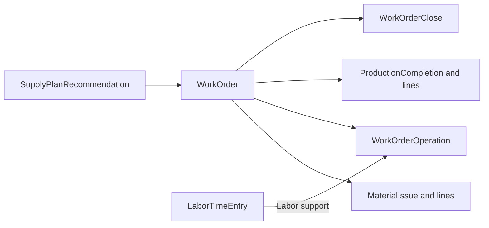
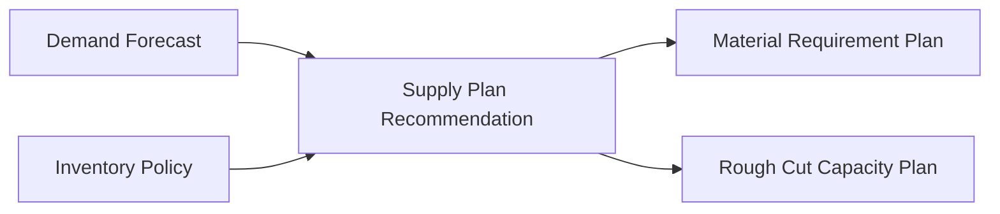
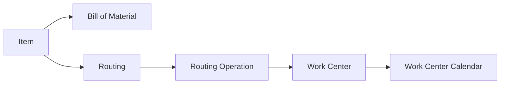
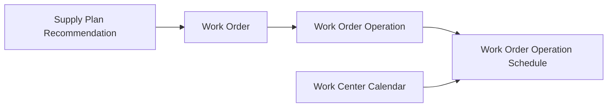
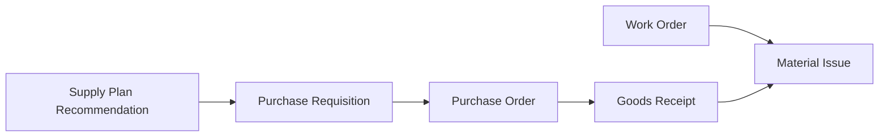
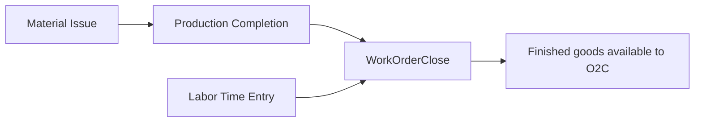

import BpmnDiagram from "@site/src/components/BpmnDiagram";

# Manufacturing Process

## Some Products Must Be Made

The operations planner in our furnishing story has another supply question. Charles River buys finished merchandise, but it also manufactures selected products. Supplying those goods means arranging components, production work, and employee time.

The question is **how materials become finished goods, and how accounting explains the cost of that change**. Continue the fictional company situation here; actual work orders must be selected from the dataset rather than assumed to belong to the customer's project.

The purchasing chapter established how components arrive in inventory. Manufacturing begins with a plan for using those resources. It then records production activity and distinguishes physical completion from the accounting work needed to close the order.

## Prepare the Product and the Work

A product needs a component recipe and a sequence of production steps. The recipe is the **bill of material**, commonly called a **BOM**. It identifies the components used to make the selected finished good.

The sequence of steps is the **routing**. Each step belongs to a work center, the location or resource where that production work is organized. These definitions describe how the item is intended to be made. They do not establish what happened on a particular production order.

Planning considers expected demand, inventory policy, and available supply. A recommendation to manufacture then provides support for a **work order**, the record organizing production of an item. The work order has its own operations and execution schedule.

A recommendation is therefore an expectation or proposed supply action. The work order moves the story into execution. Detailed capacity planning and daily operation schedules answer different questions and are retained in the optional reference.

The operations planner must also consider components. Purchasing can help supply raw materials and packaging, but buying a component and issuing it into production are separate events. The receipt belongs to P2P; its subsequent use belongs to manufacturing.

## Issue Materials into Production

Warehouse staff issue components to the work order. The material-issue record identifies the movement from available component inventory into production.

Accounting calls the accumulated value still in production **work in process**, or **WIP**. In this dataset, a material issue increases WIP and reduces materials and packaging inventory. The components are no longer available stock in the same sense as goods still on the shelf.

The work order gives this movement a purpose. To investigate consumption, identify the selected work order, its issued lines, and their quantities and dates. A company-wide purchasing total cannot by itself explain what one work order consumed.

The production recipe supplies a comparison point, while the material-issue records supply execution evidence. A difference needs interpretation: establish the scope, quantities, and timing before describing it as waste or an error.

## Support Production with People's Work

Production staff perform the work-order operations. Approved attendance and labor allocations support the explanation of employee time used in production.

Those records answer operational questions about hours and their allocation. Payroll records employee earnings and obligations through its own cycle. Finance then uses payroll-supported reclassification entries to connect manufacturing labor and burden to costing.

This means the labor-support records and the inventory valuation method are related but distinct. Charles River's dataset remains **standard-cost based**. Recording actual hours does not turn every finished item into an inventory value calculated from the complete actual cost of that individual order.

You will follow approved time and payroll in the next chapter. For now, keep the handoff in view: production needs supported labor, payroll establishes employee cost and liabilities, and accounting uses the relevant cost support.

## Complete the Goods

Production completion records finished goods becoming available in inventory. This is the handoff that allows completed products to support later customer fulfillment.

The model values the completion at standard manufacturing cost. Its accounting increases finished-goods inventory and credits the relevant WIP and manufacturing-clearing amounts. **Manufacturing clearing** helps connect the standard conversion amounts with the manufacturing cost support recorded through other events.

The practical distinction comes first: goods can be physically complete and available even while their work order awaits accounting close. To explain availability, inspect the completion evidence. To explain whether costs and residual balances have been resolved, inspect the close evidence.

A completed quantity is also different from a customer's delivered quantity. Completion brings goods into inventory; a later shipment takes goods out through Order-to-Cash. Those events have their own documents and dates.

## Close the Work Order

Cost accounting reviews the work-order amounts and closes residual WIP and manufacturing-clearing balances. The resulting difference is recorded as manufacturing variance.

Completion and close can occur on different dates. A work order can therefore be physically completed in one period and closed in another. Combining them into a single event would obscure both the availability of goods and the timing of the accounting resolution.

A variance is a result to explain. It does not prove waste, misconduct, or an approval failure. Identify the cost basis, supporting events, and close timing before deciding what further evidence or action is needed.

This is also where the controller's company-wide view matters. Payroll support, factory overhead, and equipment depreciation may contribute to manufacturing accounting without being another physical production step. Their detailed treatments remain in the reference below.

## Follow the Manufacturing Responsibilities

**How do Planning, Warehouse, Production, and Cost Accounting cooperate?** Start with the supply need, follow release and execution, and then separate completion from close.

<BpmnDiagram modelId="manufacturing-conversion" />

Read the model in three stages: prepare the work, make the goods, and resolve the accounting. The purchasing handoff supplies needed components; the payroll connection supplies labor-cost support.

The model describes teaching responsibilities. Its lanes and recorded close fields do not establish an independently enforced release or variance-approval workflow.

## Connect Production Events to Their Records

This map asks **which records show that materials were used, goods were completed, and the order was closed**.

Begin with the work order and follow each related event. The branches are different kinds of evidence around the same order; they are not interchangeable measures of progress or cost.

| Event | Accounting meaning in the published model |
|---|---|
| Planning recommendation and work-order setup | Support the intended work without directly posting its production cost |
| Material issue | Transfer component cost into WIP |
| Production completion | Recognize finished goods at standard cost |
| Manufacturing cost support | Connect labor and other manufacturing costs through their own postings |
| Work-order close | Resolve residual balances and recognize variance |

## Explain Completed Goods on an Open Order

Suppose the controller finds a completion dated before period end and a close dated afterward. The first question is whether the finished-goods event was recorded; the second is what remained unresolved in the work-order accounting.

Use the reporting date to explain both positions. The later close can explain the resolution of residual balances without implying that the goods were unavailable before it.

Likewise, a weekly capacity signal does not establish the date an operation actually ran. Use the record appropriate to the question: planning pressure, execution timing, goods availability, or accounting close.

## Check Your Understanding

Must goods wait for work-order close before becoming finished-goods inventory?

No. Production completion establishes the finished-goods event at standard cost. Work-order close subsequently resolves residual WIP and manufacturing-clearing balances and records variance.

Does having actual labor-hour records make this a full actual-cost inventory system?

No. Actual labor support helps explain production and payroll-supported costing, while completion remains standard-cost based. State which cost basis you are using before comparing amounts.

## Next Steps

The production story depends on people's work. Continue to [Payroll](payroll.md) to follow that work from attendance and approval into employee pay and later liability settlement.

For an initial data investigation, the [manufacturing cost-flow exercise](../learn-and-practice/manufacturing-cost-flow.md) follows one work order through its accounting events.

## Optional Reference

Return to these sections when you have a specific question or an assignment that uses the data. The chapter above can be read without opening a file.

Look up documents, accounting entries, and traceability fields

### Core Tables and What They Represent

| Process stage | Main tables | Grain or event represented | Why students use them |
|---|---|---|---|
| Planning and replenishment pressure | `DemandForecast`, `InventoryPolicy`, `SupplyPlanRecommendation`, `MaterialRequirementPlan`, `RoughCutCapacityPlan` | Weekly forecast, policy, replenishment signal, exploded component demand, and weekly load-versus-capacity tieout | Explain why manufacturing demand existed before any work order was released |
| Standard manufacturing design | `Item`, `BillOfMaterial`, `BillOfMaterialLine`, `Routing`, `RoutingOperation`, `WorkCenter`, `WorkCenterCalendar` | Product recipe, operation sequence, and available work-center capacity | Understand how an item is supposed to be built |
| Work-order release and schedule | `WorkOrder`, `WorkOrderOperation`, `WorkOrderOperationSchedule` | One production order, its operation sequence, and its daily scheduled hours | Review finite scheduling, execution timing, and open production activity |
| Component support and issue | `PurchaseRequisition`, `PurchaseOrder`, `GoodsReceipt`, `MaterialIssue`, `MaterialIssueLine` | Purchased support for missing components and the physical issue of material into WIP | Trace whether materials were available and when they were consumed |
| Labor support and cost traceability | `EmployeeShiftRoster`, `TimeClockEntry`, `LaborTimeEntry`, `PayrollRegister`, `JournalEntry` | Approved attendance, labor allocation, payroll support, and later reclass activity | Connect factory labor support to work-order cost analysis |
| Completion and close | `ProductionCompletion`, `ProductionCompletionLine`, `WorkOrderClose` | Finished-goods completion event and final variance close | Separate physical completion from accounting close and variance analysis |

### When Accounting Happens

| Event | Business meaning | Accounting effect |
|---|---|---|
| Material issue | Components are moved from stock into work in process | Debit `1046` Inventory - Work in Process and credit `1045` Inventory - Materials and Packaging |
| Production completion | Finished goods are completed from WIP at standard manufacturing cost | Debit `1040` Inventory - Finished Goods, credit `1046` Inventory - Work in Process, and credit `1090` Manufacturing Cost Clearing |
| Work-order close | Accounting clears residual WIP and clearing balances and recognizes manufacturing variance | Debit or credit `5080` Manufacturing Variance with the offset to unresolved WIP or clearing balances |
| Direct labor and overhead reclass support | Payroll-supported manufacturing labor and burden are moved into manufacturing costing flows | Journal-driven reclass from payroll expense pools into direct labor or manufacturing overhead paths |
| Manufacturing equipment depreciation | Monthly fixed-asset depreciation is recorded for plant equipment tied to manufacturing work centers | Debit `1090` Manufacturing Cost Clearing and credit `1186` Accumulated Depreciation - Manufacturing Equipment |

### Key Traceability and Data Notes

- `SupplyPlanRecommendation` is the planning bridge into both `WorkOrder` and purchased replenishment support.
- `MaterialRequirementPlan` is the component-demand explosion tied back to one manufacturing recommendation.
- `RoughCutCapacityPlan` is a weekly planning tieout and should not be used as the daily execution schedule.
- `WorkOrderOperationSchedule` is the daily schedule for operation-timing and capacity-use questions.
- `LaborTimeEntry` is the bridge from approved time into manufacturing cost traceability, especially when linked to `WorkOrderOperationID`.
- `WorkOrderClose` is the accounting close event, not the physical production event.
- `FixedAsset.BehaviorGroup`, `WorkCenterID`, and `DepreciationDebitAccountID` explain why plant equipment depreciation flows into `1090`, while warehouse equipment still remains outside product cost.
- Manufacturing stays standard-cost based even though payroll and time provide operational labor support beneath that costing layer.

Explore detailed process and analysis paths

### Analytical Subsections

### Planning, MRP, and Rough-Cut Capacity

Why was manufacture recommended? Follow weekly planning into component requirements and rough-cut capacity. These records describe expected demand and load before detailed production execution.

**Tables involved**

| Table | Role in the flow |
|---|---|
| `DemandForecast` | Shows the weekly demand signal behind planned replenishment |
| `InventoryPolicy` | Shows safety stock, reorder logic, and lead-time assumptions |
| `SupplyPlanRecommendation` | Shows the planned manufacture signal by week, item, and warehouse |
| `MaterialRequirementPlan` | Shows exploded component demand created from the planned manufacture signal |
| `RoughCutCapacityPlan` | Shows weekly planned load versus available work-center hours |

:::warning
`RoughCutCapacityPlan` is a weekly planning tieout, not the same thing as `WorkOrderOperationSchedule`. Use rough-cut rows for planning pressure and `WorkOrderOperationSchedule` for daily execution timing.
:::

**Starter analytical question:** Which manufactured recommendations created both component pressure and rough-cut capacity pressure before execution began?

**Analytical plan**

- Objective: Link manufactured recommendations to component demand and weekly capacity pressure.
- Evidence path: SupplyPlanRecommendation -> MaterialRequirementPlan and RoughCutCapacityPlan.
- Comparison: Group by item, work center, warehouse, or bucket week.

### Standard Recipe, Routing, and Work Centers

What recipe and production steps define the item? Follow its bill of material into component requirements and its routing into work-center operations. This is the standard design against which execution can be compared.

**Tables involved**

| Table | Role in the flow |
|---|---|
| `Item` | Identifies which products are manufactured and stores standard cost components |
| `BillOfMaterial`, `BillOfMaterialLine` | Define the component recipe for the finished good |
| `Routing`, `RoutingOperation` | Define the ordered operation path through the factory |
| `WorkCenter`, `WorkCenterCalendar` | Define where the work happens and how much daily time is available |

**Starter analytical question:** Which manufactured item groups use the most complex routing or the heaviest component structure?

**Analytical plan**

- Objective: Compare recipe complexity and routing complexity across manufactured items.
- Evidence path: Item -> BillOfMaterial -> BillOfMaterialLine and Item -> Routing -> RoutingOperation.
- Comparison: Group by item group, collection, or work center.

### Work Order Release and Operation Scheduling

How was the recommendation put into production? Follow the released work order into its operations and daily schedule. Compare release, due, scheduled, and actual dates when explaining the progress of the work.

**Tables involved**

| Table | Role in the flow |
|---|---|
| `SupplyPlanRecommendation` | Shows the planning row that supported the work-order release |
| `WorkOrder` | Shows the released production order |
| `WorkOrderOperation` | Shows the operation-level execution plan and actual progression |
| `WorkOrderOperationSchedule` | Shows the daily scheduled hours for each operation |
| `WorkCenterCalendar` | Shows the daily capacity that the schedule was placed against |

**Key joins**

- `WorkOrder.SupplyPlanRecommendationID -> SupplyPlanRecommendation.SupplyPlanRecommendationID`
- `WorkOrderOperation.WorkOrderID -> WorkOrder.WorkOrderID`
- `WorkOrderOperationSchedule.WorkOrderOperationID -> WorkOrderOperation.WorkOrderOperationID`
- `WorkOrderOperationSchedule.WorkCenterID -> WorkCenterCalendar.WorkCenterID`

**Analytical plan**

- Objective: Trace one released work order from planning support into operation-level daily schedule rows.
- Evidence path: SupplyPlanRecommendation -> WorkOrder -> WorkOrderOperation -> WorkOrderOperationSchedule.
- Comparison: Compare release date, due date, schedule date, and actual operation timing.

### Purchased Component Support and Material Issue

How did purchased components support production? Inspect the purchasing and receiving evidence alongside the later material issue to the work order. Receipt brings components into stock; issue moves their cost into WIP.

**Tables involved**

| Table | Role in the flow |
|---|---|
| `PurchaseRequisition`, `PurchaseOrder`, `GoodsReceipt` | Show how P2P supports missing materials and packaging |
| `WorkOrder` | Anchors the production order that consumes the components |
| `MaterialIssue`, `MaterialIssueLine` | Show when material actually moved into WIP |

**Starter analytical question:** Which work orders depended on purchased component support before material could be issued into production?

**Analytical plan**

- Objective: Compare upstream purchased support to the later physical issue of components into WIP.
- Evidence path: SupplyPlanRecommendation -> PurchaseRequisition and WorkOrder -> MaterialIssue -> MaterialIssueLine.
- Comparison: Compare receipt timing, issue timing, and work-order release timing.

### Labor Capture, Payroll Bridge, and Manufacturing Cost

Which approved work supports the operation's labor explanation? Follow `TimeClockEntry` into `LaborTimeEntry` and the work-order operation. Payroll supplies the pay-cycle accounting support, while journals carry the subsequent labor and overhead reclassifications.

**Tables involved**

| Table | Role in the flow |
|---|---|
| `EmployeeShiftRoster`, `TimeClockEntry` | Show planned and approved labor support beneath payroll |
| `LaborTimeEntry` | Shows the costing bridge from approved time into production analysis |
| `WorkOrderOperation` | Shows which operation consumed the direct labor support |
| `PayrollRegister` | Shows the payroll-side source behind later reclass activity |
| `JournalEntry` | Shows direct-labor and manufacturing-overhead reclass support |

**Starter analytical question:** Which work centers or work orders show the highest approved labor support relative to planned operation timing?

**Analytical plan**

- Objective: Connect approved factory time to work-order operations and payroll-supported reclass activity.
- Evidence path: TimeClockEntry -> LaborTimeEntry -> WorkOrderOperation, plus PayrollRegister and JournalEntry.
- Comparison: Group by work center, work order, payroll period, or labor type.

### Production Completion, Close, and Finished-Goods Availability

When were goods available, and when was their order closed? Compare `ProductionCompletion` and `WorkOrderClose` separately. Completion recognizes finished goods at standard cost; close resolves the remaining variance and balances.

**Tables involved**

| Table | Role in the flow |
|---|---|
| `MaterialIssue` | Shows material already consumed into WIP before completion |
| `LaborTimeEntry` | Shows labor support that contributes to cost traceability |
| `ProductionCompletion`, `ProductionCompletionLine` | Show the physical completion event and standard finished-goods cost detail |
| `WorkOrderClose` | Shows the final close and manufacturing variance event |

**Starter analytical question:** Which work orders were physically completed in one period but not closed until a later period?

**Analytical plan**

- Objective: Separate physical completion from accounting close and finished-goods availability.
- Evidence path: WorkOrder -> ProductionCompletion -> ProductionCompletionLine -> WorkOrderClose.
- Comparison: Compare completion date, close date, quantity completed, and variance amount by month.

Follow specialized process branches

<BpmnDiagram modelId="manufacturing-variances" />

Read completion, cost support, and `WorkOrderClose` as distinct evidence. A recorded variance is an accounting result to interpret, not proof of waste, an unauthorized transaction, or a separate approval workflow.

Evaluate controls and try the optional AIS activity

### Risks, Controls, and Evidence

| Risk and control objective | Evidence available | Teaching boundary |
|---|---|---|
| Unsupported production: connect execution to a documented plan | `SupplyPlanRecommendation`, `WorkOrder.SupplyPlanRecommendationID`, release and employee fields | A planning link supports traceability; it does not prove that a separate release-approval control operated |
| Incorrect consumption or labor allocation: support the work-order cost trail | `MaterialIssueLine`, `LaborTimeEntry`, `WorkOrderOperation` | Compare records at their own grain; an independent consumption reconciliation is a **proposed teaching control** |
| Incomplete close: explain residual balances and variance | `ProductionCompletionLine`, `WorkOrderClose`, `GLEntry` | `ClosedByEmployeeID` identifies recorded responsibility; an independent variance sign-off is a **proposed teaching control**, not a stored approval chain |

### Optional AIS Activity: Evaluate a Conversion Handoff

**Context and objective:** an operations and finance review needs to explain how a work order moved from planned demand to finished goods and accounting close. Use the BPMN responsibilities to identify a risk without confusing standard-cost accounting with operational actual labor support.

**Prerequisites, tools, and sources:** complete the manufacturing cost-flow exercise linked above and review WIP, manufacturing clearing, and variance. Use a SQL tool with the published SQLite file, or Excel with filters and lookups, plus a copy of the editable Draw.io model. Sources are `SupplyPlanRecommendation`, `WorkOrder`, `WorkOrderOperation`, `WorkOrderOperationSchedule`, `MaterialIssueLine`, `MaterialIssue`, `LaborTimeEntry`, `ProductionCompletion`, `ProductionCompletionLine`, `WorkOrderClose`, and `GLEntry`.

1. Record the release, chosen work order, scope, and reporting date. Mark its planning, execution, completion, and close evidence on the model.
2. Compare the event dates and distinguish an open work order from completed goods awaiting accounting close. Retain document grain and state the cost basis of every amount.
3. Propose one review of consumption, labor support, or close. Label it a **proposed teaching control** and specify its risk, objective, owner, evidence, test, and limitation using the [workshop matrix](../learn-and-practice/bpmn-controls-workshop.md).

**Assessed deliverable:** submit the annotated process model, a reproducible event and cost schedule, and the matrix row. Explain what evidence would change a production or accounting decision. The records do not establish a complete actual-cost inventory system, every shop-floor action, or the effectiveness of an unrecorded control. Extend the investigation through the existing manufacturing case and operations reports below.

Choose a further investigation

### Questions for Further Investigation {#common-student-questions}

- Which products are manufactured and which are purchased?
- Which manufactured recommendations created the most component demand or rough-cut capacity pressure?
- Which items use the most complex BOM or routing structure?
- Which work centers look busiest by week or month?
- Which work orders remained open at period end?
- Which work orders had schedule pressure before actual execution began?
- Which work orders depended on purchased component support before material issue?
- How much direct labor is tied to each work order and operation?
- Which work orders were completed but not yet closed?
- How much manufacturing variance was posted by month, work center, or item group?

- Read [Production and Planning](../analytics/index.md#production-and-planning) to compare utilization, forecasts, and capacity; add [Purchasing and Inventory](../analytics/index.md#purchasing-and-inventory) for supply reliability and coverage.
- Read [Manufacturing Labor Case](../analytics/cases/manufacturing-labor-cost-case.md) when you want a guided walkthrough from production support into costing and close.
- Read [Explain Profit, Cash, and the Year-End Close](../analytics/cases/financial-statement-bridge-case.md) when you want to add plant-equipment depreciation and note-financed equipment into the manufacturing-cost story.
- Read [P2P](p2p.md) to see how raw materials and packaging are replenished when manufacturing needs purchased support.
- Read [Payroll](payroll.md#time-attendance-and-approved-hours) for approved attendance support and [Payroll](payroll.md#direct-labor-and-manufacturing-reclass) for the labor and reclass side of the same production story.
- Read [GLEntry Posting Reference](../reference/posting.md) and [Schema Reference](../reference/schema.md) when you need the detailed posting or join logic.

