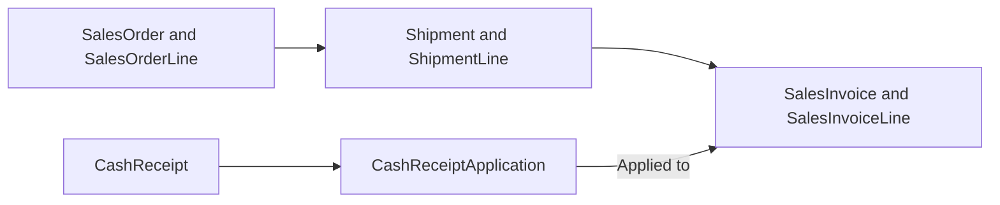
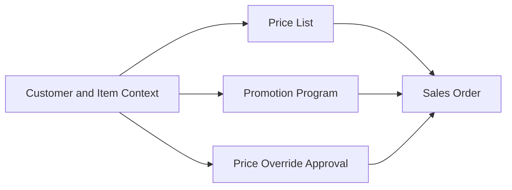
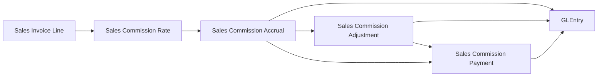
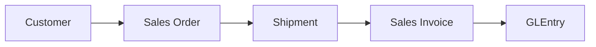
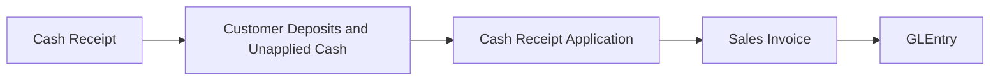
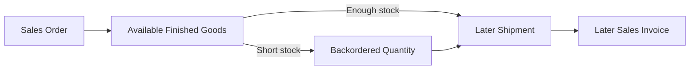
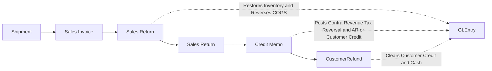
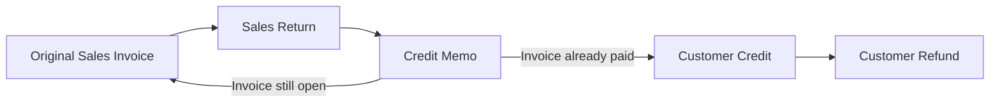

import BpmnDiagram from "@site/src/components/BpmnDiagram";

# Order-to-Cash Process

## The Customer's Order Starts the Work

Return to the furnishing project in our [company story](../learn-the-business/company-story.md). The design-trade customer has selected goods, and the sales coordinator records the request. The immediate question is practical: **what has the company promised, and what still needs to happen before the invoice is settled?**

This is an illustrative customer situation, not a transaction to search for. You can understand the process here without opening the dataset. Later, you will select actual records for a tracing exercise.

Order-to-cash, or O2C, connects the customer's order with fulfillment, billing, and settlement. Sales, the warehouse, customer accounting, and treasury each contribute evidence. Their activities answer different questions about the same commercial relationship.

## Record the Promise, Then Fulfill It

The sales coordinator records the goods, quantities, and commercial terms on the sales order. This gives operations a statement of demand. In the dataset, the order itself creates no ledger posting: no goods have yet left inventory and no customer invoice has been posted.

The warehouse then considers what can be shipped. Available stock may support fulfillment, while a backordered quantity awaits supply. An order can therefore lead to more than one shipment. To explain a delivery concern, compare the requested goods with what actually shipped, keeping the dates and quantities in view.

A shipment records goods leaving inventory. This is the point at which the dataset recognizes the inventory reduction and cost of goods sold. Outbound freight also has its own expense and accrual effect. Those costs arise from fulfillment even though customer billing is a separate event.

The operations planner's supply work continues behind this activity. Purchased goods depend on inventory and replenishment; manufactured goods also depend on production. The later purchasing and manufacturing chapters explain those responsibilities. An O2C investigation starts with what the warehouse actually fulfilled.

## Bill the Goods That Shipped

Customer accounting prepares the invoice using the shipped goods as support. The invoice tells the customer what is being charged and records a receivable, the amount owed to Charles River. The dataset records goods revenue at this invoicing event.

This separation makes timing visible. The order shows what was requested, the shipment shows what left inventory, and the invoice shows what was billed. You need each document to explain whether demand was fulfilled and whether shipped goods were invoiced.

In a goods-sale trace, an invoice line links to the shipment line it bills. The order and invoice totals alone cannot establish that relationship. Freight billed to the customer and sales tax also need to be distinguished from merchandise revenue when interpreting an invoice.

The customer may have design work billed as well. That work follows approved hours rather than a shipment. We will follow it in the next chapter; first, complete the goods-sale settlement path.

## Receive the Money and Apply It

Treasury records customer money when it arrives. Customer accounting then identifies which invoice or invoices it settles. The record of that allocation is called a cash application.

In this dataset, a cash receipt increases cash and customer deposits or unapplied cash. Applying the receipt reduces that balance and reduces accounts receivable. This two-stage treatment lets you distinguish money received from an invoice actually settled.

A receipt can be applied across invoices, and an invoice can have settlement activity over time. To explain its open balance, examine the relevant applications as of the reporting date. A convenient receipt reference on an invoice-related record is not a substitute for that application evidence.

For the sales coordinator, the customer relationship may look complete once delivery has occurred. For the controller, the questions continue: was the delivery billed, what is owed, and what has been settled? Each answer belongs to a particular event and date.

## Follow the Responsibilities

**Who hands the work to whom?** Read the main BPMN from the customer's request through Sales, Warehouse, Accounting, and Treasury. A lane shows a responsibility; arrows within the company show the sequence of activities.

<BpmnDiagram modelId="order-to-cash" />

Start with the available-stock decision, then follow fulfillment into billing. At the cash-allocation review, notice that money can remain unapplied. Reaching that review's endpoint does not mean every invoice has been fully settled.

The lanes are a teaching model. They do not prove that recorded tasks were performed independently by different employees. Actual employee and approval fields support that separate investigation.

## Connect the Events to the Records

The following map answers a narrower question: **which records help explain the goods, the bill, and its settlement?** You do not need to memorize the table names. Read them as labels for documents you now understand.

Follow the goods across the top path. Then follow received money through its application to the invoice. This is a reading map; detailed joins belong to the reference sections below.

The principal accounting events in the published model are:

| Event | What changes in the accounts |
|---|---|
| Sales order | No ledger posting |
| Shipment | Inventory decreases; cost of goods sold and outbound freight expense are recognized |
| Invoice | Receivables increase, with revenue and applicable tax recorded |
| Cash receipt | Cash and customer deposits or unapplied cash increase |
| Cash application | Customer deposits or unapplied cash and receivables decrease |

Detailed postings include freight, commissions, and other related amounts. Start by explaining the events above before combining those additional effects.

## When Cash Arrives Before Allocation Is Complete

Suppose the controller is reviewing receivables at period end. The customer has sent money, but a receipt has not yet been fully applied. That situation calls for an explanation of both the cash balance and the invoice balance.

The receipt establishes that money was recorded. Applications establish how much reduced the selected invoice by the cutoff. A later application may explain eventual settlement without changing the earlier reporting-date position.

An open invoice is therefore a starting point for investigation. Check its due date, applications, credits, and reporting date before describing a collection failure. The ordinary cash path also has a returns branch: a credit memo can affect what remains owed, and a refund is a separate cash event.

## Bridge an Event to an Entry

These are the existing [Lessons 4–6 sale records](../learn-and-practice/find-the-accounting-entries.md#3-tell-the-event-to-entry-story), not the illustrative furnishing project. The table widens the selected order-line trace to **complete event vouchers**; the shipment and invoice contain two goods lines.

| Event and date | Supporting evidence | Why the accounts change | Cutoff question |
|---|---|---|---|
| Order, 2024-01-24 | SalesOrder 11 and its lines | No posting: a commercial promise is not delivered goods or recognized revenue | What quantity is still unfulfilled? |
| Shipment, 2024-01-31 | Shipment 87 and its ledger voucher | Debit COGS 5,985.33 / credit finished goods 5,985.33; debit freight-out expense 104.01 / credit accrued expenses 104.01 | What inventory left, and what freight liability remains? |
| Invoice, 2024-01-31 | SalesInvoice 202 and its ledger voucher | Debit AR 12,248.33; credit goods revenue 11,397.78, freight revenue 103.00, and tax payable 747.55 | Which applications or credits exist by the chosen cutoff? |
| Receipt, 2024-02-22 | CashReceipt 173 | Debit cash / credit customer deposits and unapplied cash, 952.07 each | Has this receipt been allocated by this date? |
| Application, 2024-02-23 | CashReceiptApplication 225 | Debit customer deposits and unapplied cash / credit AR, 952.07 each | What remains after **all** relevant dated settlement records? |

**Predict before revealing:** On February 22, does receipt 173 itself reduce invoice 202’s AR? What changes the next day?

Reveal the event distinction

The receipt increases cash and unapplied customer money. Application 225 reduces AR on February 23 without a second cash inflow. Exclude that application from a February 22 cutoff. These two records alone do not establish the invoice’s full balance; inspect its other applications and relevant credits. [Lesson 6](../learn-and-practice/find-the-accounting-entries.md#3-tell-the-event-to-entry-story) checks all 15 ledger rows and separates complete vouchers from one selected goods line.

## Check Your Understanding

The order is recorded. Has the dataset recognized the goods revenue?

No. The order records demand and commercial terms. Shipment records fulfillment and inventory cost; the sales invoice records the receivable and goods revenue in this model.

A receipt exists, but the invoice still appears open. What should you inspect?

Inspect the applications to that invoice and their dates, alongside any relevant credits. The receipt alone does not establish how much of the invoice was settled at the selected reporting date.

## Next Steps

**Continue the company story.** The customer also needs design help. Continue to [Design Services](design-services.md) to follow work delivered through staff time.

**Investigate this process.** Finish [Lesson 1](../learn-and-practice/meet-the-records.md), [Lesson 2](../learn-and-practice/read-an-order.md), and [Lesson 3](../learn-and-practice/connect-the-records.md), plus [Excel setup](../analytics/excel-guide.md) or [SQL setup](../analytics/sql-guide.md). Then follow [Lesson 4: Follow a Goods Sale](../learn-and-practice/source-to-ledger.md), followed by [Lesson 5: Follow Customer Settlement](../learn-and-practice/follow-customer-settlement.md) and [Lesson 6: Find the Accounting Entries](../learn-and-practice/find-the-accounting-entries.md). Check the selected lesson’s further prerequisites before beginning.

## Optional Reference

Return to these sections when you have a specific question or an assignment that uses the data. The chapter above can be read without opening a file.

Look up documents, accounting entries, and traceability fields

### Core Tables and What They Represent

| Process stage | Main tables | Grain or event represented | Why students use them |
|---|---|---|---|
| Pricing and commercial setup | `PriceList`, `PriceListLine`, `PromotionProgram`, `PriceOverrideApproval` | Pricing rules, promotions, and rare override approvals behind a sales line | Review commercial terms, pricing controls, and margin drivers |
| Order capture | `SalesOrder`, `SalesOrderLine` | Customer order header and ordered line | See promised demand, ordered quantity, and freight terms before fulfillment |
| Service delivery and staffing | `ServiceEngagement`, `ServiceEngagementAssignment`, `ServiceTimeEntry` | One customer engagement, the employees assigned to it, and approved daily service hours | Review service staffing, approved billable versus non-billable time, and labor-cost snapshots |
| Service billing trace | `ServiceBillingLine` | Monthly billed-hours rollup tied to one invoice line | Trace approved service hours into billed revenue without using shipment logic |
| Sales commissions | `SalesCommissionRate`, `SalesCommissionAccrual`, `SalesCommissionAdjustment`, `SalesCommissionPayment`, `SalesCommissionPaymentLine` | Commission rate rules, invoice-line accruals, return clawbacks, and sales-rep payments | Trace selling expense, commission payable, and settlement timing |
| Fulfillment | `Shipment`, `ShipmentLine` | Physical shipment event and shipped line | Measure what actually left the warehouse, carrier choice, and shipment-level freight accrual |
| Billing | `SalesInvoice`, `SalesInvoiceLine` | Invoice header and billed line | Trace receivable creation, merchandise revenue, and billed freight back to shipment |
| Cash receipt | `CashReceipt` | Cash arrival from the customer | Review collection timing, unapplied cash, and deposit behavior |
| Settlement | `CashReceiptApplication` | Application of received cash to one or more invoices | Measure true invoice settlement and open-AR reduction |

### When Accounting Happens

| Event | Business meaning | Accounting effect |
|---|---|---|
| Shipment | Goods physically leave inventory and customer fulfillment occurs | Debit COGS and freight-out expense, and credit inventory plus accrued expenses for outbound freight |
| Sales invoice | Accounting bills shipped quantity and creates the customer receivable | Debit AR and credit merchandise revenue, freight revenue, and sales tax payable |
| Service invoice | Accounting bills approved design-service hours for the month | Debit AR and credit `4080` Sales Revenue - Design Services plus sales tax payable, with no shipment-driven inventory or COGS entry |
| Sales commission accrual | Accounting recognizes commission earned on invoice-line revenue | Debit `6290` Sales Commission Expense and credit `2034` Sales Commission Payable |
| Sales commission adjustment | A credit memo reverses commission on returned revenue | Debit `2034` Sales Commission Payable and credit `6290` Sales Commission Expense |
| Sales commission payment | Accounting pays prior-month net commissions to sales reps | Debit `2034` Sales Commission Payable and credit cash |
| Cash receipt | Customer money arrives, even if it is not yet matched to a specific invoice | Debit cash and credit customer deposits or unapplied cash |
| Cash application | Accounting settles one or more open invoices with previously received cash | Debit customer deposits or unapplied cash and credit AR |

### Key Traceability and Data Notes

- `SalesInvoiceLine.ShipmentLineID` is the main shipment-to-invoice traceability field in the normal O2C path.
- Service invoice lines stay in `SalesInvoiceLine`, but `ShipmentLineID` stays null for those rows because no physical shipment occurred.
- `SalesOrder.FreightTerms`, `Shipment.FreightCost`, `Shipment.BillableFreightAmount`, and `SalesInvoice.FreightAmount` show how outbound freight moves from commercial policy into operational cost and customer billing.
- `CashReceiptApplication` is the true settlement table because it shows which invoices the cash actually cleared.
- `CashReceipt.SalesInvoiceID` is compatibility metadata only and should not be treated as the authoritative settlement link.
- `SalesOrderLine` carries pricing lineage through `BaseListPrice`, `PriceListLineID`, `PromotionID`, `PriceOverrideApprovalID`, and `PricingMethod`.
- `ServiceBillingLine` is the authoritative hours-to-invoice bridge for design services, and `ServiceTimeEntry` is the approved-hours source behind that billing.
- `SalesCommissionAccrual` is the invoice-line commission bridge. Its base is `SalesInvoiceLine.LineTotal`; freight, sales tax, deposits, AR timing, and unapplied cash are outside the commission base.
- `SalesCommissionAdjustment` records credit-memo clawbacks, and `SalesCommissionPaymentLine` shows which accruals and adjustments were included in each sales-rep payment.
- Some receipts remain unapplied for a period of time, which is useful for open-AR, unapplied-cash, and settlement-timing analysis.

Explore detailed process and analysis paths

### Analytical Subsections

### 1. Pricing and Commercial Terms

What explains the price on an order line? Follow the base price, promotion, and any approved override into the recorded pricing method. Compare those inputs before interpreting margin or a pricing exception. The [Schema Reference](../reference/schema.md) identifies the full relationships.

**Tables involved**

| Table | Role in the flow |
|---|---|
| `PriceList`, `PriceListLine` | Provide the base commercial price by customer or segment scope |
| `PromotionProgram` | Adds the promotion-based discount when one valid promotion applies |
| `PriceOverrideApproval` | Captures rare below-floor approval support |
| `SalesOrderLine` | Stores the final pricing lineage on the ordered line |

**Starter analytical question:** Which sales lines used standard price-list logic versus promotion pricing versus approved override logic?

**Analytical plan**

- Objective: Compare pricing method, promotion use, and override approvals.
- Evidence path: SalesOrderLine -> PriceListLine -> PriceList, plus PromotionProgram and PriceOverrideApproval.
- Comparison: Group by PricingMethod, customer segment, item group, or sales rep.

### 2. Sales Commissions and Payable Settlement

Commission accounting starts from posted customer invoice lines. The routine applies a simple rate matrix by revenue type and customer segment, accrues the expense to a dedicated payable, reverses part of that payable when a credit memo claws back returned revenue, and pays sales reps monthly in arrears.

**Tables involved**

| Table | Role in the flow |
|---|---|
| `SalesCommissionRate` | Holds the active commission-rate matrix by revenue type and customer segment |
| `SalesCommissionAccrual` | Records one commission accrual for each eligible invoice line |
| `SalesCommissionAdjustment` | Records credit-memo clawbacks tied back to the original accrual |
| `SalesCommissionPayment` | Records monthly net commission payments by sales rep |
| `SalesCommissionPaymentLine` | Shows which accruals and adjustments were included in the payment |

**Starter analytical question:** Which sales reps and customer segments generated the highest net commission expense after credit-memo clawbacks?

**Analytical plan**

- Objective: Review commission expense and clawbacks by rep, segment, and month.
- Evidence path: SalesCommissionAccrual -> SalesCommissionAdjustment, plus Employee and Customer.
- Comparison: Compare gross commission expense, clawbacks, and net commission expense by revenue type.

### 3. Shipment to Invoice Traceability

Which shipped goods support the billed revenue? Follow the shipment line into the invoice line, retaining both dates and quantities. This view supports cutoff, completeness, and occurrence questions; the [Schema Reference](../reference/schema.md) provides the full entity relationships.

**Tables involved**

| Table | Role in the flow |
|---|---|
| `SalesOrder`, `SalesOrderLine` | Show the original customer promise, ordered quantity, and freight terms |
| `Shipment`, `ShipmentLine` | Show what actually shipped, when it shipped, and the shipment-level freight accrual |
| `SalesInvoice`, `SalesInvoiceLine` | Show what was billed from the shipped quantity and whether freight was billed to the customer |
| `GLEntry` | Shows the posted receivable, revenue, COGS, and freight effects |

**Key joins**

- `ShipmentLine.SalesOrderLineID -> SalesOrderLine.SalesOrderLineID`
- `SalesInvoiceLine.ShipmentLineID -> ShipmentLine.ShipmentLineID`
- `GLEntry.SourceDocumentType` plus `SourceDocumentID` or `SourceLineID` for posting trace

**Analytical plan**

- Objective: Trace billed revenue back to the shipped line that supported it.
- Evidence path: SalesOrderLine -> ShipmentLine -> SalesInvoiceLine.
- Comparison: Filter invoice and shipment dates by month-end to test cutoff timing.

### 4. Cash Receipt, Application, and Settlement

Which invoice did the money settle? Follow a receipt into its applications, then inspect the amounts and dates applied to the selected invoice. This separates cash arrival from settlement for open-receivable and unapplied-cash analysis.

**Tables involved**

| Table | Role in the flow |
|---|---|
| `CashReceipt` | Records when customer cash arrived |
| `CashReceiptApplication` | Records which invoices were actually settled |
| `SalesInvoice` | Provides the receivable being cleared |
| `GLEntry` | Shows cash, liability, and AR-clearing effects |

:::warning
Do not use `CashReceipt.SalesInvoiceID` as the main settlement link. The authoritative settlement path is `CashReceiptApplication`, because one receipt can settle multiple invoices and some cash can remain unapplied temporarily.
:::

**Analytical plan**

- Objective: Separate cash arrival from invoice settlement.
- Evidence path: CashReceipt -> CashReceiptApplication -> SalesInvoice.
- Comparison: Compare receipt date, application date, and invoice due date for open-AR review.

### 5. Design Services and Monthly Hour Billing

Hourly billing uses approved service time rather than shipment evidence. Follow the [Design Services chapter](design-services.md) for engagement, staffing, monthly billing, and labor-margin interpretation.

### 6. Backorder to Shipment Lag

Where did time pass between the order, shipment, and invoice? Compare their dates while retaining the ordered and fulfilled quantities. Inventory shortages and partial fulfillment can explain timing differences that deserve closer investigation.

**Tables involved**

| Table | Role in the flow |
|---|---|
| `SalesOrderLine` | Shows the original promised quantity |
| `ShipmentLine` | Shows what quantity left inventory and when |
| `SalesInvoiceLine` | Shows when the delayed shipment was billed |

**Starter analytical question:** Which customers or item groups show the longest lag between order capture, shipment, and billing?

**Analytical plan**

- Objective: Measure fulfillment lag from ordered quantity to shipped quantity and billed quantity.
- Evidence path: SalesOrderLine -> ShipmentLine -> SalesInvoiceLine.
- Comparison: Compare order date, shipment date, and invoice date by customer, item group, or month.

Follow specialized process branches

<BpmnDiagram modelId="cash-application" />

The matching decision explains application versus remaining unapplied cash. The detail includes receipt capture for context; the parent allocation review starts after that receipt. It is a teaching interpretation of the records, not evidence of an automated exception queue or a one-to-one execution binding between diagrams.

<BpmnDiagram modelId="returns-credit-refunds" />

A physical return restores inventory. An approved credit memo reduces open receivables and retains any excess as customer credit; one memo can do both. A later refund clears customer credit in cash. These events need not occur together. Mermaid links show relationship endpoints rather than an exclusive business gateway; use the detailed BPMN allocation step and actual `GLEntry` rows when a memo spans both.

### Returns, Credits, and Refunds

Some sales do not end with the original invoice. In this dataset, returns are the main customer-side exception path inside O2C, not a separate business cycle. The exception starts from something that was already shipped and billed, then moves through physical return, financial correction, and sometimes cash refund if the customer had already paid.

| Exception stage | Main tables | Why students use them |
|---|---|---|
| Original billed shipment | `ShipmentLine`, `SalesInvoiceLine` | Identify the shipment and invoice that the correction started from |
| Physical return | `SalesReturn`, `SalesReturnLine` | Show returned quantity and the operational return event |
| Financial correction | `CreditMemo`, `CreditMemoLine` | Show the customer-facing credit and its allocation to AR, customer credit, or both |
| Cash resolution | `CustomerRefund` | Show when customer credit was returned in cash |

| Event | Business meaning | Accounting effect |
|---|---|---|
| Sales return | Goods come back after a shipment and invoice already existed | Debit inventory and credit COGS |
| Credit memo | Accounting reverses part of the original sale | Debit sales returns and allowances, freight revenue when policy allows a freight credit, and tax reversal, then credit AR, customer credit, or both |
| Customer refund | Treasury clears customer credit in cash | Debit customer credit and credit cash |

**Traceability notes**

- `SalesReturnLine.ShipmentLineID` is the core operational return trace field.
- `CreditMemo.OriginalSalesInvoiceID` ties the financial correction back to the earlier invoice.
- `CreditMemo.FreightCreditAmount` shows when part of the original billed freight was credited back because the return reason justified it.
- `CreditMemoLine` preserves the original pricing lineage through `BaseListPrice`, `PriceListLineID`, `PromotionID`, `PriceOverrideApprovalID`, `PricingMethod`, and `Discount`.
- `CustomerRefund` is used only when the return scenario leaves customer credit that is later cleared in cash.

This local lineage view distinguishes AR correction from customer credit. Its labeled links illustrate common endpoint relationships, not an exclusive gateway or a rule that every memo generates a refund. A memo may reduce the remaining AR and create excess customer credit in the same posting, including after partial settlement. Treasury may later clear that credit through `CustomerRefund`; reconcile both account effects at the selected date.

Evaluate controls and try the optional AIS activity

### Risks, Controls, and Evidence

| Risk and control objective | Evidence available | Teaching boundary |
|---|---|---|
| Unauthorized pricing: support an exceptional price with approval | `SalesOrderLine.PriceOverrideApprovalID` and `PriceOverrideApproval` request and approval fields | Test the selected population; the presence of a record does not prove every override was authorized |
| Incomplete billing: account for shipped quantities | `ShipmentLine` and `SalesInvoiceLine.ShipmentLineID` | An independent shipment-to-invoice reconciliation is a **proposed teaching control**, not a stored automated blocking rule |
| Incorrect settlement or refund: distinguish cash, AR, and customer credit | `CashReceiptApplication`, `CreditMemo` approval fields, `CustomerRefund` | Compare authorizers and dates; do not infer a complete control procedure from lane separation |

### Optional AIS Activity: Assess a Customer Handoff

**Context and objective:** accounting needs a defensible view of whether goods fulfillment was billed and settled at a stated date. Interpret the BPMN model, identify a business risk, and connect a control objective to actual source evidence.

**Prerequisites, tools, and sources:** complete the goods-sale tracing exercise linked above. Use the published SQLite file with a SQL tool, or the Excel workbook with filters and lookups, plus the editable Draw.io model. Work from `SalesOrderLine`, `ShipmentLine`, `SalesInvoiceLine`, their headers, `CashReceiptApplication`, `CashReceipt`, and `GLEntry`. Add `PriceOverrideApproval`, `CreditMemo`, or `CustomerRefund` only if your selected issue needs that evidence.

1. Record the release, scope, reporting date, and actual document and line keys. Mark the corresponding activities and responsibilities on a copy of the model.
2. Compare demand, fulfillment, billing, and application dates without duplicating header totals. Identify an observed gap or timing difference; do not assume a violation.
3. Write one risk/control-matrix row naming the risk, objective, proposed owner, evidence, test, and limitation. Label any added independent review or hold as a **proposed teaching control**.

**Assessed deliverable:** submit the annotated model, a reproducible evidence table, and the risk/control row. Explain which observation could change a business decision and what follow-up evidence would be needed. One trace cannot establish population completeness, operational effectiveness, or misconduct. Extend the work through the existing O2C case and reports below; the [BPMN and controls workshop](../learn-and-practice/bpmn-controls-workshop.md) supplies a reusable matrix format.

Choose a further investigation

### Questions for Further Investigation {#common-student-questions}

- Which orders shipped immediately and which became backorders?
- Which shipment lines were invoiced later than the shipment date?
- Which invoices remain open after cash applications?
- Which customers pay one invoice at a time versus several at once?
- Which pricing methods appear most often by customer segment or item family?
- Which shipment lines were later returned?
- Which returns reduced open AR versus created customer credit?
- How do revenue, receivables, unapplied cash, collections timing, and return corrections differ by period?

- Read [Sales and Customers](../analytics/index.md#sales-and-customers) to compare revenue, pricing, receivables, customer credits, and deposits.
- Read [Statements and Cash](../analytics/index.md#statements-and-cash) to connect those results with working capital and cash conversion.
- Read [Design Services](design-services.md) when you want the full staffing, approved-hours, and monthly service-billing branch that now sits inside customer revenue.
- Read [Resolve a Customer Account Review](../analytics/cases/o2c-trace-case.md) when you want a guided walkthrough from order through posting and settlement.
- Jump to [Returns, Credits, and Refunds](#returns-credits-and-refunds) when you want the main O2C exception path.
- Read [GLEntry Posting Reference](../reference/posting.md) and [Schema Reference](../reference/schema.md) when you need the detailed posting or join logic.

