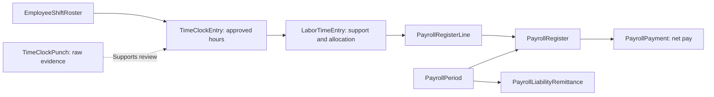
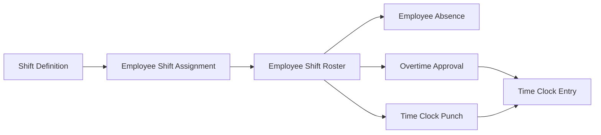
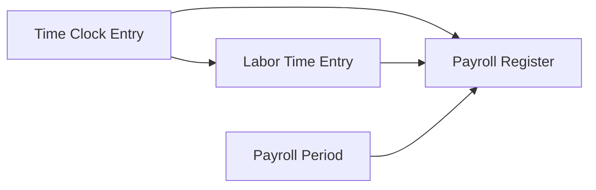
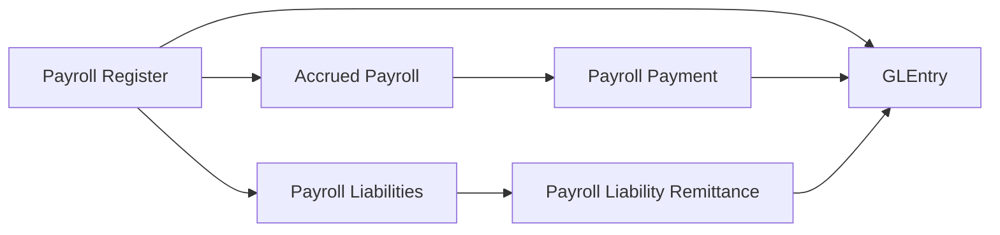
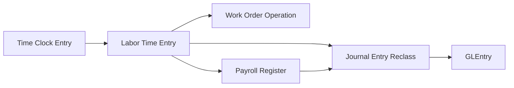
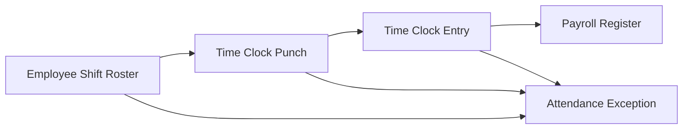

import BpmnDiagram from "@site/src/components/BpmnDiagram";

# Payroll Process

## People's Work Creates Several Obligations

The manufacturing chapter introduced employees' work as part of production. The design-services chapter introduced staff time supporting customers. Payroll now asks **how the company supports employee earnings, records the cost, and settles the obligations that follow**.

Continue our fictional company situation by considering an hourly production employee over a pay period. This is a teaching example, not an identified employee in the file. Payroll also serves the wider workforce, so the customer's furnishing project cannot explain every payroll record.

The ordinary path begins with expected work and attendance evidence. It then moves into approved hours, a payroll calculation, employee payment, and later remittances. Each stage supplies a different part of the explanation.

## Establish the Work Expected and Recorded

A shift defines an expected work pattern. Assignments and rosters place employees into planned workdays. Those records establish what was scheduled, not what was actually worked.

Raw clock punches provide evidence of attendance. An arrival or departure event is useful support, but raw punches are not the approved payroll-hours source in this dataset. Approved daily time records supply the regular and overtime hours used for hourly payroll.

Supervisors provide the approval support. Absence and overtime records can add context when expected and recorded hours differ. An attendance exception identifies something for review; it does not by itself establish misconduct or an automatic payroll hold.

For the first reading, keep three questions separate: what work was expected, what evidence was recorded, and what hours were approved? Payroll needs the approved result, while an investigation may return to the underlying evidence.

## Turn Approved Hours into Earnings

Payroll uses approved time to support hourly earnings for the pay period. Regular and overtime hours contribute to the employee's gross pay according to the model's earnings calculations.

A **payroll register** records the employee's payroll result, with detail lines for earnings, deductions, and employer amounts. It is the main payroll accounting event rather than another attendance record.

**Gross pay** is the employee's earnings before deductions. **Employee deductions** reduce the amount paid to the employee and create amounts owed elsewhere. **Net pay** is the amount owed to the employee after those deductions. **Employer costs**, such as employer payroll burden, add company expense and related obligations without simply becoming employee net pay.

The distinction explains why one payroll result can create several liabilities. Employee payment addresses net pay; taxes, withholding, and other deductions have their own settlement responsibilities.

## Record the Payroll, Then Settle It

Approved attendance does not directly post payroll expense. The payroll register records the expense and liability picture for the period.

Treasury later pays employee net pay. The payroll-payment event reduces accrued payroll and cash. It answers whether the employee obligation was settled, with its own payment date.

Treasury also remits payroll-related liabilities to agencies and benefit providers. These remittances reduce the relevant withholding, tax, and deduction liabilities and cash. Their timing can differ from the employee payment.

This gives the controller two settlement questions: were employees paid, and which other payroll liabilities remain outstanding? Answering the first does not answer the second. The same pay period can have settled employee net pay and open remittance balances at a reporting date.

## Follow the Payroll Responsibilities

**How does attendance support become payroll, and who settles the resulting obligations?** Follow Employees and Supervisors into Payroll, then inspect Treasury's two settlement branches.

<BpmnDiagram modelId="payroll" />

The model separates employee payment from liability remittance. Its parallel settlement branches describe the need to complete both kinds of obligation; they do not require both to occur on the same day.

Employees are part of the company participant. Agencies and benefit providers are external recipients. The lane arrangement helps you follow responsibility, while actual approval and payment records establish the evidence for a selected period.

## Connect Time, Payroll, and Settlement

This map answers **which records support approved work and which establish the accounting and settlement events**.

Follow approved hourly support into earnings detail. Then distinguish employee-level payroll from period-level liability remittances. Repeating a period-level remittance beside every employee would multiply the same amount.

| Stage | Accounting meaning |
|---|---|
| Approved daily time | Supports hourly payroll; no direct posting by itself |
| Payroll register | Records expense, employee net-pay liability, and related payroll liabilities |
| Employee payment | Reduces accrued payroll and cash |
| Liability remittance | Reduces the relevant payroll liabilities and cash |

The dataset's ledger source label for register postings is `PayrollSummary`. The [Posting Reference](../reference/posting.md#payrollsummary-register-summaries) explains that mapping; source labels should not be assumed to match table names.

## Connect Payroll Back to Production and Design

For manufacturing, labor allocations can connect approved work to a work-order operation. Payroll then supports labor and overhead reclassifications into manufacturing costing. Those connections add cost support while preserving the standard-cost completion model.

Design-service employees also move through payroll, but engagement analysis uses service-time cost snapshots. Their labor remains payroll period expense. A customer billing rate, a service-time cost rate, and a payroll amount answer different questions.

These links let you explain how employee costs relate to the work already encountered in the story. They do not justify attaching the company's entire payroll to one order, work order, or engagement.

## Explain Liabilities After Employees Are Paid

Suppose the controller sees employee payments but a payroll liability remains at period end. Begin with the liability category and the reporting date. Inspect the register support and the corresponding remittance evidence.

A later remittance may explain subsequent clearance. It does not erase the earlier outstanding obligation. Equally, an attendance exception calls for review of its support and status before drawing conclusions about earnings or employee conduct.

Preserving the grain of each record helps keep these explanations reliable: daily attendance, employee payroll, and period-level remittances are related evidence at different levels.

## Bridge an Event to an Entry

Reuse [Lesson 10’s employee 109, period 1](../learn-and-practice/follow-hours-into-payroll.md). Keep the selected employee result separate from period-wide remittances and period/cost-center ledger summaries.

| Event and date basis | Supporting evidence | Why the accounts change | Cutoff question |
|---|---|---|---|
| January 1–14 approved attendance | TimeClockEntry; PayrollPeriod 1 | No posting: approved time supports hourly payroll rather than independently recording wages | Are hours approved and in the selected period? |
| January 19 register approval/posting | PayrollRegister 96; period/cost-center PayrollSummary voucher | Debit wage and employer-cost expense; credit accrued net pay and other payroll liabilities | What register population is summarized in the complete voucher? |
| Employee payment, January 19 | PayrollPayment 96 | Debit accrued payroll / credit cash, 1,578.34 each | Is employee net pay settled by the cutoff, and has bank clearance occurred? |
| Period-wide remittances, January 26, 29, and 31 | PayrollLiabilityRemittance for period 1 | Debit the respective withholding, tax, or deduction liability / credit cash | Which liability categories remain at the chosen cutoff? |

The selected employee’s gross-to-net check is 1,902.64 − 324.30 = 1,578.34. Payment 96 is a complete two-row balanced voucher. **Register 96 is not a complete PayrollSummary voucher**: that ledger source groups register facts by period and cost center. Follow the [source mapping](../reference/posting.md) before comparing independently aggregated payroll and ledger amounts.

**Predict before revealing:** On January 20, does the recorded employee payment establish that period 1’s tax and benefit obligations have also been settled?

Reveal the settlement boundary

No. Employee payment is recorded January 19 and clears the bank January 22. None of the three period-wide remittances is recorded by January 20. Do not allocate those whole-period amounts to this employee merely because the records share a period key.

## Check Your Understanding

Which record supplies the approved hours for hourly payroll?

The approved daily attendance record, `TimeClockEntry`. Raw punches provide underlying evidence for review; they are not the authoritative approved-hours result.

Employees have received net pay. Have all payroll liabilities cleared?

Not necessarily. Employee payment clears net pay, while withholding, tax, and deduction liabilities require their own remittance evidence as of the reporting date.

## Next Steps

**Continue the company story.** The controller brings customer, supplier, production, and workforce activity together. Continue to [Manual Journals and Close](manual-journals-and-close.md) to see finance record estimates and reporting adjustments.

**Investigate this process.** Finish [Lesson 1](../learn-and-practice/meet-the-records.md), [Lesson 2](../learn-and-practice/read-an-order.md), and [Lesson 3](../learn-and-practice/connect-the-records.md), plus [Excel setup](../analytics/excel-guide.md) or [SQL setup](../analytics/sql-guide.md). Then follow [Lesson 10: Follow Hours into Payroll](../learn-and-practice/follow-hours-into-payroll.md). Check the selected lesson’s further prerequisites before beginning.

## Optional Reference

Return to these sections when you have a specific question or an assignment that uses the data. The chapter above can be read without opening a file.

Look up documents, accounting entries, and traceability fields

### Core Tables and What They Represent

| Process stage | Main tables | Grain or event represented | Why students use them |
|---|---|---|---|
| Shift and attendance setup | `ShiftDefinition`, `EmployeeShiftAssignment`, `EmployeeShiftRoster`, `EmployeeAbsence`, `OvertimeApproval` | Expected shift pattern, planned workday, absence support, and approved overtime support | Review workforce expectations before payroll is calculated |
| Raw attendance evidence | `TimeClockPunch` | Individual punch events under the approved daily summary | Compare raw attendance evidence to approved time and exception review |
| Approved daily attendance | `TimeClockEntry` | One approved worked-day row for hourly payroll support | Measure authoritative regular and overtime hours for hourly employees |
| Labor traceability | `LaborTimeEntry`, `WorkOrderOperation` | Labor allocation row tied to costing and sometimes to a routing operation | Trace approved time into payroll support and manufacturing labor |
| Gross-to-net payroll | `PayrollPeriod`, `PayrollRegister`, `PayrollRegisterLine` | One employee payroll header with earnings, deductions, and employer burden detail | Analyze payroll posting, gross-to-net logic, and liability creation |
| Employee settlement | `PayrollPayment` | Net-pay settlement event | Review when accrued payroll clears in cash |
| Liability remittance | `PayrollLiabilityRemittance` | Payment of payroll withholding, tax, and deduction liabilities | Separate employee payment from agency and vendor settlement |
| Control review | `AttendanceException`, `GLEntry`, `JournalEntry` | Exception log and posted accounting records | Support audit, payroll control, and manufacturing reclass analysis |

### When Accounting Happens

| Event | Business meaning | Accounting effect |
|---|---|---|
| Approved time entry | Daily attendance is approved for payroll and labor support | No direct posting by itself |
| Payroll register | Payroll calculates gross pay, employee deductions, and employer burden | Debits salary and wage expense plus payroll burden accounts, credits accrued payroll and payroll-related liabilities |
| Payroll payment | Treasury clears employee net pay | Debit `2030` Accrued Payroll and credit cash |
| Payroll liability remittance | Treasury clears withholding, employer-tax, and deduction liabilities | Debit `2031`, `2032`, or `2033` and credit cash |
| Direct labor or overhead reclass | Payroll-supported manufacturing labor and burden move into costing flows | Journal-driven reclass from payroll expense pools into manufacturing clearing or overhead paths |

### Key Traceability and Data Notes

- `TimeClockEntry` is the approved daily attendance source for hourly payroll. It is the main worked-hours record for payroll support.
- `TimeClockPunch` is raw support beneath that approved layer and should be treated as evidence, not as the authoritative payroll-hours source.
- `LaborTimeEntry` is the bridge from approved time into costing and payroll traceability, especially when direct manufacturing labor is tied to `WorkOrderOperationID`.
- `PayrollRegister` is the main payroll accounting event. It creates the expense and liability picture for the period.
- `PayrollPayment` and `PayrollLiabilityRemittance` are separate settlement paths. One clears employee net pay, and the other clears withholding and deduction liabilities later.
- `AttendanceException` sits beside the normal flow as a control-review table rather than as a posting event.
- Design-service labor stays in payroll expense under the `Design Services` cost center. Customer-engagement margin is analyzed through `ServiceTimeEntry`, not capitalized into inventory or manufacturing clearing.

Explore detailed process and analysis paths

### Analytical Subsections

### Time, Attendance, and Approved Hours

Which hours were expected, recorded, and approved? Follow shifts and rosters into punch evidence and the approved `TimeClockEntry`. The approved daily result supplies payroll hours; the underlying records support its review.

**Tables involved**

| Table | Role in the flow |
|---|---|
| `ShiftDefinition`, `EmployeeShiftAssignment` | Define the expected shift pattern for hourly workers |
| `EmployeeShiftRoster` | Shows who was scheduled to work, where, and for how many hours |
| `EmployeeAbsence`, `OvertimeApproval` | Capture planned absences and approved extra hours |
| `TimeClockPunch` | Stores raw punch evidence beneath the approved summary |
| `TimeClockEntry` | Stores the approved worked day that payroll uses | 

:::warning
`TimeClockPunch` is raw evidence, not the authoritative payroll-hours source. Use `TimeClockEntry` when the question is about approved hours, regular pay, overtime pay, or payroll support.
:::

**Starter analytical question:** Which work centers show the biggest gap between rostered hours, approved hours, and approved overtime?

**Analytical plan**

- Objective: Compare expected hours, raw attendance evidence, and approved daily time.
- Evidence path: EmployeeShiftRoster -> TimeClockPunch -> TimeClockEntry, plus EmployeeAbsence and OvertimeApproval.
- Comparison: Group by work center, shift, or payroll period.

### Approved Hours to Gross Pay

Once daily time is approved, payroll turns that support into gross pay. Hourly earnings use approved `TimeClockEntry` hours, while `LaborTimeEntry` adds the labor-traceability layer that helps students connect approved time to payroll lines and direct manufacturing support.

**Tables involved**

| Table | Role in the flow |
|---|---|
| `TimeClockEntry` | Supplies approved regular and overtime hours for hourly payroll |
| `LaborTimeEntry` | Carries the costing and payroll-support bridge at the labor-entry level |
| `PayrollPeriod` | Anchors the biweekly payroll calendar |
| `PayrollRegister`, `PayrollRegisterLine` | Store gross-to-net payroll and the supporting detail lines | 

**Key joins**

- `TimeClockEntry.PayrollPeriodID -> PayrollPeriod.PayrollPeriodID`
- `LaborTimeEntry.TimeClockEntryID -> TimeClockEntry.TimeClockEntryID`
- `PayrollRegisterLine.LaborTimeEntryID -> LaborTimeEntry.LaborTimeEntryID`
- `PayrollRegister.PayrollRegisterID -> PayrollRegisterLine.PayrollRegisterID`

**Analytical plan**

- Objective: Trace approved hourly support into earnings lines on the payroll register.
- Evidence path: TimeClockEntry -> LaborTimeEntry -> PayrollRegisterLine, plus PayrollRegister.
- Comparison: Compare regular and overtime hours to regular and overtime earnings by employee or period.

### Gross-to-Net, Payment, and Remittance

Which payroll obligations were created and settled? Follow the register into employee net-pay payments and the separate period-level remittances. Compare their dates before explaining which liabilities remain.

**Tables involved**

| Table | Role in the flow |
|---|---|
| `PayrollRegister`, `PayrollRegisterLine` | Create the gross-to-net and liability detail for each employee |
| `PayrollPayment` | Clears employee net pay |
| `PayrollLiabilityRemittance` | Clears tax and deduction liabilities later |
| `GLEntry` | Shows the posted expense, liability, and cash effects | 

**Starter analytical question:** Which payroll liabilities remain open after employees are paid, and how long do those remittance balances stay outstanding?

**Analytical plan**

- Objective: Separate payroll posting from employee payment and later remittance.
- Evidence path: PayrollRegister -> PayrollPayment and PayrollLiabilityRemittance, with GLEntry for posted effect.
- Comparison: Compare approved payroll date, payment date, and remittance date by payroll period.

### Direct Labor and Manufacturing Reclass

Payroll also feeds manufacturing. When approved time and labor support are tied to work-order operations, the dataset can trace direct labor into production analysis and then reclass payroll-supported amounts through direct-labor and manufacturing-overhead journals.

**Tables involved**

| Table | Role in the flow |
|---|---|
| `TimeClockEntry`, `LaborTimeEntry` | Carry approved time and labor allocation into costing analysis |
| `WorkOrderOperation` | Shows which routing operation consumed the direct labor |
| `PayrollRegister` | Provides the payroll-side source for the later reclass logic |
| `JournalEntry`, `GLEntry` | Show the accounting effect of direct-labor and overhead reclass | 

**Key joins**

- `LaborTimeEntry.WorkOrderOperationID -> WorkOrderOperation.WorkOrderOperationID`
- `PayrollRegisterLine.LaborTimeEntryID -> LaborTimeEntry.LaborTimeEntryID`
- `GLEntry.SourceDocumentType` plus `SourceDocumentID` for reclass trace

**Analytical plan**

- Objective: Trace direct manufacturing labor from approved time into payroll support and reclass accounting.
- Evidence path: TimeClockEntry -> LaborTimeEntry -> WorkOrderOperation, plus PayrollRegisterLine and reclass journals.
- Comparison: Group by work order, work center, item, or payroll period.

### Design-Service Labor Support

Not every labor-support question in the dataset ends in manufacturing. Design employees can support customer engagements directly. In that path, payroll still records the wages and liabilities in the normal way, but `ServiceTimeEntry` carries the approved billable and non-billable hours plus the labor-cost snapshot used for customer-engagement margin analysis.

Manufacturing labor can be reclassified into production costing. Design-service labor remains payroll period expense; service-time records supply the cost snapshots for engagement analysis.

### Attendance Exceptions and Control Review

Which attendance concerns need follow-up? Use `AttendanceException` to connect a logged issue with roster expectations, punch evidence, approved hours, and any downstream payroll support. Inspect its status and evidence before reaching a conclusion.

**Tables involved**

| Table | Role in the flow |
|---|---|
| `EmployeeShiftRoster` | Defines the planned shift baseline |
| `TimeClockPunch` | Shows raw evidence when attendance is questioned |
| `TimeClockEntry` | Shows the approved time that payroll used |
| `AttendanceException` | Stores the logged control-review issue |
| `PayrollRegister` | Helps students see whether the exception still affected paid payroll | 

**Starter analytical question:** Which exception types are most common by work center, and how often do they still end up supporting paid hourly payroll?

**Analytical plan**

- Objective: Compare planned shifts, raw attendance evidence, approved time, and logged exceptions.
- Evidence path: AttendanceException -> EmployeeShiftRoster and TimeClockEntry, with TimeClockPunch for evidence.
- Comparison: Group by exception type, work center, supervisor, or payroll period.

Evaluate controls and try the optional AIS activity

### Risks, Controls, and Evidence

| Risk and control objective | Evidence available | Teaching boundary |
|---|---|---|
| Unsupported paid hours: relate approved hours to attendance evidence | `EmployeeShiftRoster`, `TimeClockPunch`, `TimeClockEntry`, `OvertimeApproval`, `EmployeeAbsence` | Raw punches are evidence, not the authoritative hours source; compare specific approval fields and dates |
| Unresolved attendance concern: identify follow-up before drawing a conclusion | `AttendanceException` status, reviewer, and review-date fields | A logged issue does not prove misconduct, an automatic pay hold, or completed review |
| Incomplete liability settlement: distinguish employee net pay from remittances | `PayrollRegister`, `PayrollPayment`, `PayrollLiabilityRemittance`, `GLEntry` | An independent liability roll-forward and approval review is a **proposed teaching control**; payment alone does not establish all obligations cleared |

### Optional AIS Activity: Evaluate Time and Settlement Evidence

**Context and objective:** a payroll review needs to distinguish supported hourly earnings, employee payment, and later liability remittance. Read the model's responsibilities and identify one control objective without treating every attendance exception as wrongdoing.

**Prerequisites, tools, and sources:** review gross-to-net payroll and the time-source distinctions on this page. Use a SQL tool with the published SQLite file, or Excel filters and lookups, plus a copy of the editable Draw.io model. Sources are `Employee`, `PayrollPeriod`, `EmployeeShiftRoster`, `TimeClockPunch`, `TimeClockEntry`, `AttendanceException`, `PayrollRegister`, `PayrollRegisterLine`, `PayrollPayment`, `PayrollLiabilityRemittance`, and `GLEntry`. Add absence, overtime, or labor records when relevant.

1. State the release, employee, pay period, reporting date, and source keys. Annotate the approved-time, register, and settlement activities.
2. Compare selected hourly support with earnings, then inspect employee payment and period-level remittances separately. Do not duplicate a period-level remittance across employee register rows.
3. Propose one independent review and label it a **proposed teaching control**. State its risk, objective, owner, evidence, test, and unresolved follow-up in the [workshop matrix](../learn-and-practice/bpmn-controls-workshop.md).

**Assessed deliverable:** submit an annotated model, a reproducible evidence schedule that preserves each source's grain, and the risk/control row. Explain which liability or attendance issue warrants review as of the selected date and what cannot be concluded from the records. The sample does not establish all employee entitlements, successful bank execution, or control effectiveness. Continue through the existing attendance and workforce cases and payroll reports below.

Choose a further investigation

### Questions for Further Investigation {#common-student-questions}

- Which employees are hourly and expected to have approved time-clock support?
- How do approved regular and overtime hours turn into gross pay?
- Which liabilities remain open after payroll is posted?
- How do payroll payments differ from payroll liability remittances?
- Which work centers generate the most approved overtime?
- Which direct labor entries are tied to specific work-order operations?
- Which attendance exceptions still appear alongside approved or paid payroll activity?
- How does payroll support manufacturing labor analysis without changing the dataset to full actual-cost inventory?

- Read [People and Payroll](../analytics/index.md#people-and-payroll) to connect people cost, approved time, payroll cash, liabilities, and control review in one report topic.
- Read [Explain Staffing, Overtime, and Payroll Cost](../analytics/cases/workforce-coverage-and-attendance-case.md) or [Investigate Exceptions and Recommend Controls](../analytics/cases/audit-review-pack-case.md) when you want a guided payroll or time-control investigation.
- Jump to [Time, Attendance, and Approved Hours](#time-attendance-and-approved-hours) when you want the upstream support layer for hourly payroll.
- Read [Manufacturing](manufacturing.md) when you want the production side of direct labor and work-order traceability.
- Read [GLEntry Posting Reference](../reference/posting.md) and [Schema Reference](../reference/schema.md) when you need the detailed payroll posting or join logic.

